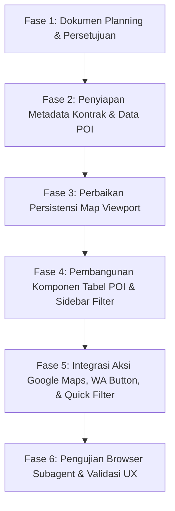

# Dokumen Perencanaan: Peningkatan Peta Potensi (Tabel POI, Filter Kontrak, Google Maps, & WhatsApp)

| **Atribut** | **Detail** |
|---|---|
| **Tanggal Pembuatan** | 12 Oktober 2026 |
| **Status** | 📋 Menunggu Persetujuan (Planning Phase) |
| **Sumber Masukan** | Tambahan dan Arahan Atasan Proyek |
| **Target Modul** | Modul Peta Potensi Pajak (PAD360) pada Dashboard Utama (`index.html`, `potensi.js`, `Map.js`, `potensi-data.js`) |
| **Dokumen Acuan** | `docs/PLANNING_TAB_PETA_POTENSI.md`, `Referensi/PAD360 Peta Potensi Pajak.html` |

---

## 1. Latar Belakang & Analisis Masukan Atasan

Berdasarkan evaluasi terhadap implementasi awal fitur **Peta Potensi**, terdapat 3 poin masukan strategis dari atasan yang perlu disempurnakan:

1. **Persistensi Posisi & Zoom Peta (Poin 1):**
   * *Kondisi Saat Ini:* Ketika pengguna beralih dari tampilan **Peta Interaktif** ke **Tabel Peringkat** lalu kembali lagi ke Peta, koordinat tampilan peta Leaflet (`center`, `zoom`, atau layer fokus) rentan ter-reset atau mengalami *re-render* yang tidak mempertahankan sudut pandang wilayah terakhir pengguna.
   * *Target:* Posisi peta (`lat`, `lng`, `zoom level`, dan state layer terpilih) harus **terkunci dan tidak berubah sama sekali** saat pengguna berpindah tab/tampilan bolak-balik antara Peta dan Tabel.

2. **Pemisahan Mode Tabel Khusus untuk Peta Potensi (Poin 2):**
   * *Kondisi Saat Ini:* Fitur tombol **Tabel Peringkat** (`btnViewTable`) saat ini hanya menampilkan tabel data agregat Profil 514 Daerah BPS. Ketika pengguna sedang berada di **Mode Peta Potensi** dan menekan tombol Tabel, mode switcher disembunyikan dan tabel yang keluar tetap tabel profil statistik daerah.
   * *Target:* Ketika berada di **Mode Peta Potensi**, peralihan ke tampilan Tabel harus menampilkan **Tabel Khusus POI (Points of Interest / Objek Potensi Pajak PAD360)** lengkap dengan **Panel Filter Terpadu di sebelah kiri** (Kategori Pajak, Wilayah/Koridor, Status Registrasi, dan Masa Kontrak).

3. **Revisi Ekstensi Informasi POI & Integrasi Tindak Lanjut (Poin 3):**
   * **Tanggal Berakhir Kontrak:** Setiap titik POI (terutama reklame komersial, sewa lahan, izin usaha) dilengkapi tanggal jatuh tempo masa kontrak/izin resmi, disertai penanda visual status masa berlaku (*Aktif*, *Mendekati Jatuh Tempo*, *Kadaluarsa*).
   * **Integrasi Google Maps:** Tautan langsung satu-klik (*One-Click Direct Link*) menuju titik koordinat presisi di Google Maps untuk memudahkan petugas lapangan/analis melakukan verifikasi visual foto satelit, ulasan (*review*), dan *Street View*.
   * **Tombol Hubungi via WhatsApp (WA Action Button):** Tombol aksi cepat untuk menghubungi pengelola/pemilik lokasi reklame atau objek pajak yang kontraknya hampir habis, lengkap dengan format pesan konfirmasi otomatis yang sopan dan profesional.
   * **Direktori Filter Khusus "Kontrak Mau Habis":** Opsi *quick filter* / *preset tab* di sidebar kiri yang memungkinkan pengguna menyaring secara instan daftar objek yang kontraknya akan berakhir dalam waktu dekat (misal: `< 30 hari` atau `< 60 hari`) sebagai antrean prioritas penagihan/perpanjangan izin.

---

## 2. Arsitektur Alur & Antarmuka Pengguna (UI/UX)

### 2.1 Matriks Tampilan Berdasarkan Mode & View

Sistem mengadopsi matriks 4 kuadran yang konsisten dan elegan:

```
                  ┌───────────────────────────────┬──────────────────────────────┐
                  │          VIEW: PETA           │         VIEW: TABEL          │
┌─────────────────┼───────────────────────────────┼──────────────────────────────┤
│ MODE:           │ [Peta Choropleth 514 Daerah]  │ [Tabel Peringkat 514 Wilayah]│
│ PROFIL DAERAH   │ + Sidebar Indikator Tematik   │ + Sorting Metrik BPS         │
├─────────────────┼───────────────────────────────┼──────────────────────────────┤
│ MODE:           │ [Peta Titik POI & Koridor]    │ [Tabel Direktori POI PAD360] │
│ PETA POTENSI    │ + Sidebar Hierarki Wilayah    │ + Sidebar Filter POI (Kiri)  │
│ (PAD360)        │ + Kontrol Koridor Lapangan    │ + Deteksi Kontrak & Aksi WA  │
└─────────────────┴───────────────────────────────┴──────────────────────────────┘
```

### 2.2 Wireframe Layout: Mode Peta Potensi — View Tabel

```
┌────────────────────────────────────────────────────────────────────────────────────────────────────────┐
│ [Logo] Portal Data Indonesia     [Cari POI/Wilayah...]   [Provinsi ▾] [Kota ▾]   [Profil | PETA POTENSI] │
│                                                                                  [  Peta  | [TABEL]   ] │
├──────────────────────────┬─────────────────────────────────────────────────────────────────────────────┤
│ SIDEBAR FILTER POI       │ DIREKTORI OBJEK POTENSI PAJAK (PAD360)                                      │
├──────────────────────────┤ Sub-header: Menampilkan 2.313 Objek Terdata · Denpasar, Bali                │
│ 🔍 Pencarian Objek       ├─────────────────────────────────────────────────────────────────────────────┤
│ [Cari nama, pemilik, Jl] │ [⚡ Semua (2.313)]  [⚠️ Kontrak Mau Habis (142)]  [🔴 Kadaluarsa (58)]        │
│                          ├─────┬──────────────────────┬─────────────┬───────────┬───────────┬──────────────┤
│ 🏷️ Kategori Pajak        │ No  │ Nama Objek / Lokasi  │ Kategori    │ Potensi   │ Kontrak   │ Aksi Cepat   │
│ [x] Reklame (Billboard)  ├─────┼──────────────────────┼─────────────┼───────────┼───────────┼──────────────┤
│ [ ] Restoran & Kafe      │ 1   │ BILLBOARD SIMPANG    │ Reklame     │ Rp 35 Jt  │ 28 Nov 26 │ [🗺️ G-Maps]  │
│ [ ] Hotel & Penginapan   │     │ Jl. Teuku Umar No.12 │ Papan LED   │ / tahun   │ (16 hari) │ [💬 WA Kontak│
│ [ ] Parkir Komersial     │     │ PT Sarana Komunika   │             │           │ [🟡 SEGERA]│ [👁️ Detail]  │
│                          ├─────┼──────────────────────┼─────────────┼───────────┼───────────┼──────────────┤
│ 📅 Masa Berlaku Kontrak  │ 2   │ BANDO JL. GATOT SUB. │ Reklame     │ Rp 65 Jt  │ 12 Okt 26 │ [🗺️ G-Maps]  │
│ (o) Semua Masa Kontrak   │     │ Jl. Gatsu Barat      │ Bando Jalan │ / tahun   │ (Hari ini)│ [💬 WA Kontak│
│ ( ) Habis < 30 Hari (⚠️) │     │ Pengelola Mandiri    │             │           │ [🔴 HABIS] │ [👁️ Detail]  │
│ ( ) Habis < 60 Hari      ├─────┴──────────────────────┴─────────────┴───────────┴───────────┴──────────────┤
│ ( ) Sudah Kadaluarsa (🔴)│ Pagination: < 1  [2]  3  4 ... 24 >  · Menampilkan 20 objek per halaman      │
└──────────────────────────┴─────────────────────────────────────────────────────────────────────────────┘
```

---

## 3. Rincian Teknis Implementasi Fitur

### 3.1 Poin 1: Persistensi Viewport Peta Tanpa Perubahan Koordinat

* **Akar Masalah:**
  Saat ini, fungsi `setViewMode('table')` menyembunyikan kontainer `#map` dengan `mapEl.style.display = 'none'`. Ketika kembali ke `setViewMode('map')`, Leaflet kerap kali kehilangan kalkulasi dimensi kontainer sehingga posisi pandang dapat tergeser atau ter-reset.
* **Solusi Teknis:**
  1. Buat mekanisme pencatat state posisi Leaflet (`cachedViewCenter` dan `cachedViewZoom`) sebelum kontainer disembunyikan atau diubah.
  2. Gunakan teknik *CSS class visibility toggle* (`visibility: hidden; position: absolute; pointer-events: none;` atau *class-based toggling*) alih-alih `display: none` total, sehingga instance Leaflet map tidak kehilangan konteks *size* dan koordinat *viewport*.
  3. Saat pengguna beralih kembali ke mode Peta:
     ```javascript
     if (this.map) {
         this.map.invalidateSize();
         if (this.savedViewCenter && this.savedViewZoom) {
             this.map.setView(this.savedViewCenter, this.savedViewZoom, { animate: false });
         }
     }
     ```

---

### 3.2 Poin 2: Tabel Khusus Peta Potensi (Detail POI & Filter Sidebar)

### 3.2 Poin 2: Tabel Khusus Peta Potensi (Detail POI & Filter Sidebar)

* **Pemisahan Independen Dua Mode Tabel:**
  * **Tabel Profil Wilayah (saat Mode Profil aktif):** Menampilkan 514 baris kabupaten/kota BPS dengan metrik: Penduduk, IPM, PDRB per kapita, Kemiskinan, dan tombol aksi "Buka Profil".
  * **Tabel Direktori Potensi POI (saat Mode Potensi aktif):** Menampilkan 2.313 baris objek pajak PAD360 dengan kolom: ID Objek, Nama Objek / Jenis, Wilayah/Koridor, Nilai Estimasi Potensi (Rp), Tanggal Berakhir Kontrak, Status Masa Berlaku, Titik Google Maps, dan Aksi Kontak WhatsApp.
* **Perbaikan Header (Mode Switcher Tetap Tampil):**
  * Tombol switcher mode (`Profil Daerah` vs `Peta Potensi`) **TIDAK LAGI disembunyikan** saat pengguna berada di tampilan tabel. Pengguna dapat berpindah langsung antara **Tabel Profil** dan **Tabel Potensi** hanya dengan sekali klik tanpa harus kembali ke peta terlebih dahulu.
* **Sidebar Kiri Khusus Tabel POI:**
  * Kontrol pencarian nama objek, nama pemilik/pengelola, atau alamat jalan.
  * *Checkbox* / *Pills* Kategori Objek Pajak (Reklame, Restoran, Hotel, Parkir, Hiburan, dll).
  * Filter Status Izin & Registrasi (Terdaftar / Verifikasi / Kandidat Baru).
  * Filter Wilayah (Provinsi & Kabupaten/Kota terintegrasi).
* **Fitur Pagination & Sorting:**
  * Mengingat terdapat 2.313 data POI, tabel dilengkapi fitur pagination (25 baris per halaman) serta kemampuan sortir berdasarkan:
    * Nama Objek (A-Z)
    * Nilai Potensi Terbesar/Terkecil
    * Tanggal Berakhir Kontrak Terdekat

---

### 3.3 Poin 3: Skema Kontrak, Google Maps, WhatsApp, & Direktori

#### A. Penambahan Struktur Data Kontrak pada Objek POI
Setiap entitas POI di dataset `potensi-data.js` diperkaya dengan atribut:
```json
{
  "id": "OBJ-REK-DPS-001",
  "name": "BILLBOARD SIMPANG TEUKU UMAR",
  "contractEnd": "2026-11-28",
  "contractStatus": "expiring_soon",
  "contactPerson": "Bpk. Hendra Gunawan",
  "contactPhone": "6281234567890",
  "googleMapsUrl": "https://www.google.com/maps/search/?api=1&query=-8.6754,115.2123",
  "gmapsRating": 4.6,
  "gmapsReviewsCount": 85
}
```

#### B. Logika Indikator Status Kontrak (Evidence-Aware)
Perhitungan dinamis berbasis selisih hari terhadap tanggal sistem (simulasi referensi Oktober 2026):
* **🔴 Kadaluarsa (Expired):** Tanggal kontrak `< tanggal hari ini`. Badge merah menyala.
* **🟡 Segera Berakhir (Expiring Soon - 30 Hari):** Selisih $\le 30$ hari. Badge kuning/oranye (*high priority alert*).
* **🔵 Berakhir dalam 60 Hari:** Selisih $31 - 60$ hari. Badge biru muda.
* **🟢 Aktif:** Selisih $> 60$ hari. Badge hijau tenang.

#### C. Integrasi Titik Google Maps (Review & Visual Tanpa Biaya API)
* **Tautan Langsung Google Maps (Opsi 1 - Gratis & Tanpa API Key):** Tombol dengan ikon Google Maps resmi yang membuka `https://www.google.com/maps/search/?api=1&query=${lat},${lng}` pada tab baru untuk memeriksa seluruh foto publik, ulasan/review pengunjung, dan Street View 360°.
* **Pratinjau Satelit & Peta di Modal (Opsi 2):** Menampilkan embed peta satelit langsung di dalam drawer/modal detail objek saat diklik, tanpa memerlukan tagihan Google Cloud.

#### D. Tombol WhatsApp Terintegrasi (Kondisional: HANYA Muncul Saat Mendekati Jatuh Tempo)
* **Aturan Visibilitas (Conditional Trigger):**
  * **Jika Sisa Hari Kontrak $\le 30$ Hari atau Sudah Kadaluarsa:** Tombol hijau **"Hubungi via WA"** otomatis **muncul dan aktif**. Ini memastikan tindakan petugas difokuskan secara presisi pada objek yang memang memerlukan konfirmasi/penagihan perpanjangan.
  * **Jika Kontrak Masih Aktif (> 30 Hari):** Tombol WhatsApp **disembunyikan** (hanya menampilkan label info `Kontrak Aktif`), mencegah petugas salah mengirimkan notifikasi.
* **Format Pesan Resmi Otomatis:**
  ```
  Halo Bpk/Ibu [Nama Kontak/Pengelola],
  
  Kami dari Tim Rekonsiliasi & Pendataan Pajak Daerah (PAD360) wilayah [Nama Kota]. 
  Berdasarkan catatan sistem kami, izin/kontrak sewa untuk objek [Nama Objek] di lokasi [Alamat Objek] tercatat akan berakhir pada tanggal [Tanggal Berakhir] ([Sisa Hari] hari lagi).
  
  Mohon konfirmasi terkait rencana perpanjangan izin dan pemenuhan kewajiban pajak reklame tersebut. Terima kasih.
  ```
* URL Generator: `https://wa.me/${phoneClean}?text=${encodeURIComponent(msg)}`

#### E. Direktori Cepat (Preset Quick-Filter)
Terdapat *Segmented Filter Bar* di atas tabel:
1. **Semua Objek** (2.313 POI)
2. **⚠️ Kontrak Mau Habis (< 30 Hari)**
3. **📅 Kontrak Habis (< 60 Hari)**
4. **🔴 Telah Lewat Tempo (Kadaluarsa)**

---

## 4. Tahapan Rencana Kerja (Implementation Phases)



### Rincian Jadwal & File yang Terlibat:
1. **Fase 1:** Pengajuan dokumen perencanaan ini kepada pengguna/atasan.
2. **Fase 2 (Data Engineering):**
   * Script update data `scripts/enrich_potensi_contracts.py` untuk menginjeksi atribut kontrak, Google Maps link, dan nomor kontak WA ke `potensi-data.js`.
3. **Fase 3 (Leaflet Viewport Fix):**
   * Penyesuaian `Map.js` dan `potensi.js` untuk mengunci koordinat `cachedView` saat beralih antara view Map dan Table.
4. **Fase 4 & 5 (Frontend Implementation):**
   * Penambahan elemen HTML `#potensiTableViewWrap` pada `index.html`.
   * Penulisan fungsi render tabel POI, pagination, dan event handler filter di `potensi.js`.
   * Styling CSS responsif di `Map.css` / `potensi.css`.
5. **Fase 6 (Quality Assurance):**
   * Uji coba via Browser Subagent untuk memastikan peralihan tab mulus, koordinat peta tidak bergeser, filter berjalan akurat, dan link WA/G-Maps berfungsi dengan benar.

---

## 5. Pertanyaan & Konfirmasi Sebelum Eksekusi

Sebelum melangkah ke eksekusi kode, mohon konfirmasi beberapa hal berikut:
1. Apakah format template pesan WhatsApp resmi di atas sudah sesuai dengan tata cara komunikasi kedinasan/operasional tim?
2. Apakah ambang batas filter *Kontrak Mau Habis* cukup ditetapkan pada **30 hari** dan **60 hari**, atau ada periode khusus lainnya (misal: 14 hari atau 90 hari)?
3. Apakah layout tabel POI di atas sudah mencakup seluruh kolom informasi yang dibutuhkan atasan?

---
*Dokumen ini dibuat secara otomatis dan siap dieksekusi setelah konfirmasi pengguna.*
