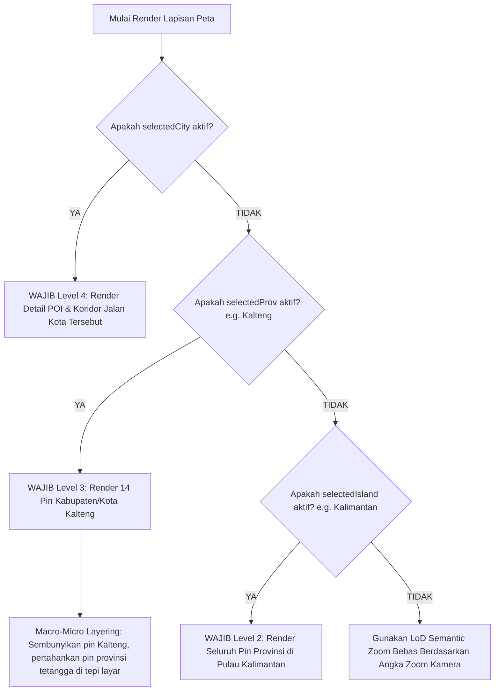
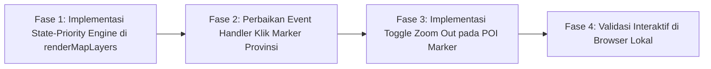

# Dokumen Perencanaan Teknis: Perbaikan Drill-Down Pin Cluster & Navigasi Zoom POI (Peta Potensi PAD360)

| **Atribut** | **Detail** |
|---|---|
| **Kode Dokumen** | `PLAN-DRILLDOWN-001` |
| **Lokasi File** | [`docs/PLANNING_FIX_DRILLDOWN_CLUSTER_DAN_ZOOM_POI.md`](file:///c:/laragon/www/PKL/mockup/docs/PLANNING_FIX_DRILLDOWN_CLUSTER_DAN_ZOOM_POI.md) |
| **Tanggal Pembaruan** | 21 Oktober 2026 |
| **Kategori** | Bugfix UX, Logic Threshold, & Navigasi Hierarki Peta |
| **Status Perencanaan** | 🟢 Selesai & Terverifikasi Pengguna |
| **Target Berkas** | [`assets/js/core/potensi.js`](file:///c:/laragon/www/PKL/mockup/assets/js/core/potensi.js), [`assets/css/styles.css`](file:///c:/laragon/www/PKL/mockup/assets/css/styles.css) |
| **Gejala / Keluhan** | Saat memilih/mengklik provinsi (contoh: Kalteng), peta melakukan zoom tetapi pin tidak pecah menjadi kabupaten/kota. Pin provinsi `63 POI Kalteng` tetap muncul bersama provinsi tetangga. Pin baru pecah setelah pengguna memutar roda scroll mouse manual sebanyak 2 kali (zoom manual). |
| **Bukti Faktual** | Tangkapan layar Provinsi Kalimantan Tengah (Breadcrumb: `Nasional > Kalimantan > Kalteng`, Dropdown: `KALIMANTAN TENGAH`, Kab/Kota: `Semua (14)`, Sidebar: `63 POI Terpetakan, Rp 7,82 M`, namun di peta masih muncul Pin Provinsi Kalteng `63 POI` bersama Kalbar `63 POI`, Kalsel `58 POI`, Kaltim `45 POI`, Sulbar `27 POI`). |

---

## 1. Analisis Kritis & Akar Masalah Teknis ([High confidence])

Berdasarkan penelusuran alur kode pada [`assets/js/core/potensi.js`](file:///c:/laragon/www/PKL/mockup/assets/js/core/potensi.js) (baris 606–640 dan 960–1100):

### 1.1 Akar Masalah Utama: Ketergantungan Kaku pada Angka Zoom Leaflet vs Luas Geografis Nyata
Pada implementasi fungsi `renderMapLayers()` dan `onSemanticZoomChange()` saat ini:
* **Zoom $\le 5.5$**: Level 1 (Nasional / 7 Wilayah Pulau)
* **Zoom $5.6 - 8.5$**: Level 2 (Provinsi — merender pin provinsi)
* **Zoom $8.6 - 11.0$**: Level 3 (Kabupaten / Kota Overview — merender pin kota)
* **Zoom $> 11.0$**: Level 4 (Detail Lapangan — POI & Koridor Jalan)

**Kelemahan Fatal**:
Wilayah geografis provinsi di Indonesia sangat beragam:
1. Provinsi berukuran kecil (seperti DKI Jakarta, DI Yogyakarta, atau Bali) memiliki bentang wilayah yang sempit sehingga saat kamera peta memfokuskan wilayahnya (*bounds*), angka zoom langsung berada di atas $8.5$. Akibatnya di Bali pin langsung pecah ke kabupaten/kota tanpa kendala.
2. Sebaliknya, provinsi berukuran raksasa seperti **Kalimantan Tengah, Kalimantan Barat, Kalimantan Timur, Papua, dan Sumatera Selatan** memiliki bentangan ratusan kilometer (Kalimantan Tengah membentang $\approx 153.564\text{ km}^2$ dari Sukamara di barat hingga Barito Timur di timur).
3. Ketika pengguna memilih **Kalimantan Tengah**, fungsi `selectProvince('kalimantan-tengah')` memanggil:
   ```javascript
   const bounds = L.latLngBounds(citiesInProv.map((c) => [c.lat, c.lng]));
   this.map.flyToBounds(bounds.pad(0.18), { duration: 1.2 });
   ```
4. Karena cakupan 14 kabupaten/kota Kalteng sangat luas, kamera Leaflet berhenti pada **Zoom 6.8 – 7.1**.
5. Karena angka **7.0 berada di bawah ambang batas 8.5**, sistem secara kaku mengeksekusi percabangan **Level 2 (Provinsi)**:
   - Peta merender pin `Kalteng (63 POI)` dan pin provinsi tetangga (`Kalbar`, `Kalsel`, `Kaltim`, `Sulbar`).
   - Sebanyak 14 Pin Kabupaten/Kota Kalteng (Palangka Raya, Kotim, Kobar, Kapuas, Barut, dll.) **sama sekali tidak di-render di peta**.

---

### 1.2 Mengapa Baru Berpecah Setelah 2 Kali Scroll Roda Mouse?
* Roda scroll mouse pada Leaflet secara default menaikkan zoom sebesar $+1.0$ level per satu step putaran.
* Setelah mengklik Kalteng, kamera berada di **Zoom $\approx 7.0$** (masih di Level 2).
* **Scroll 1x**: Zoom naik ke $\approx 8.0$ (masih $\le 8.5$, sistem tetap merender pin provinsi Kalteng).
* **Scroll 2x**: Zoom naik ke $\approx 9.0$ (sudah melewati ambang batas $8.5$, sistem akhirnya berpindah ke Level 3 dan 14 pin kabupaten/kota baru muncul).
* Hal ini menciptakan kebingungan interaksi: pengguna merasa klik pin tidak berfungsi optimal dan harus mengoreksi tampilan dengan zoom manual.

---

### 1.3 Terjebak dalam Loop Klik (*No Drill-Down Progression*)
Ketika pin `63 POI Kalteng` diklik kembali oleh pengguna:
* Event click marker hanya memanggil ulang:
  ```javascript
  marker.on('click', () => { this.selectProvince(p.id); });
  ```
* Fungsi tersebut hanya mengarahkan ulang kamera ke batas Kalteng yang sama persis (Zoom 7.0).
* Peta tidak mendekat, tidak memecah pin, dan pin tetap macet (*stuck*) di posisi semula.

---

## 2. Arsitektur Solusi: *State-Priority Resolution Engine*

Sistem render tidak boleh **hanya** menjadi budak dari angka zoom murni Leaflet, melainkan harus mengutamakan **Intensi Pengguna (State Hierarchy)**:



### 2.1 Konsep *Macro-Micro Layering* pada Level Provinsi
Ketika pengguna memilih provinsi Kalimantan Tengah:
1. **Wilayah Fokus (Micro View)**: Seluruh 14 kabupaten/kota milik Kalteng (Palangka Raya, Kotim, Kobar, dll.) **langsung dirender sebagai pin kabupaten/kota**. Pin provinsi Kalteng itu sendiri disembunyikan agar tidak menutupi ibukota/kabupaten.
2. **Wilayah Tetangga (Macro Context)**: Provinsi-provinsi tetangga yang terlihat di tepi layar (Kalbar, Kalsel, Kaltim, Sulbar) **tetap dirender sebagai pin cluster provinsi**.
3. **Hasil Visual**: Pengguna langsung melihat pemecahan 14 kabupaten/kota Kalteng secara jelas di tengah layar, sekaligus tetap mempertahankan konteks geografis pulau Kalimantan di sekelilingnya tanpa ada tabrakan pin.

---

### 2.2 Hirarki Drill-Down Progresif pada Event Klik Marker

1. **Klik Pin Pulau (Level 1)**:
   * Mengarahkan kamera ke pulau tersebut dan langsung memecah ke pin-pin provinsi di pulau itu.
2. **Klik Pin Provinsi (Level 2 — misal: Klik Pin `Kalteng 63 POI`)**:
   * Mengaktifkan `this.state.selectedProv = 'kalimantan-tengah'`.
   - Mengarahkan kamera secara asimetris ke Kalteng.
   - **Langsung memecah pin Kalteng menjadi 14 pin kabupaten/kota**.
   - Jika pengguna mengklik salah satu kota (misal: Palangka Raya), masuk ke Level 3.
3. **Klik Pin Kabupaten/Kota (Level 3 — misal: Klik Pin `Palangka Raya 8 POI`)**:
   * Mengaktifkan `this.state.selectedCity = 'palangkaraya'`.
   * Kamera terbang masuk ke Palangka Raya (Zoom 13.0).
   * Langsung memecah menjadi titik-titik POI individual (reklame, parkir, videotron) dan jalur koridor jalan.
4. **Klik Titik POI Individual (Level 4 — Toggle Zoom Out)**:
   * **Klik Pertama**: Kamera fokus ke titik objek (Zoom 16.0), drawer detail kanan terbuka.
   * **Klik Kedua pada Objek yang Sama**: Kamera melakukan *zoom-out* halus kembali ke batas seluruh kota (Zoom 13.0) agar pengguna dapat melihat titik-titik POI lain tanpa harus menggeser atau men-scroll mouse manual.

---

## 3. Matriks Perbandingan Skenario Kalimantan Tengah

| Skenario Interaksi | Kondisi Saat Ini (Bermasalah) | Solusi Baru (Setelah Diperbaiki) |
|---|---|---|
| **1. Pengguna klik pin Kalimantan, lalu klik Kalteng** | Peta zoom ke Kalteng (zoom ~7.0). Di layar masih muncul pin besar `Kalteng 63 POI` bersama provinsi tetangga. Pin kota tidak muncul. | Peta zoom ke Kalteng. Pin Kalteng **seketika lenyap dan berganti menjadi 14 pin Kabupaten/Kota** (Palangka Raya, Kotim, Kobar, dll.). |
| **2. Pengguna klik pin `Kalteng 63 POI` di peta** | Peta tidak bergerak, tidak memecah pin (*stuck* di zoom 7.0). | Pin Kalteng langsung pecah menjadi 14 titik kabupaten/kota, kamera masuk lebih dekat ke sebaran kota Kalteng. |
| **3. Scroll roda mouse** | Butuh 2x scroll manual agar zoom mencapai 9.0 baru pin kota muncul. | Tidak perlu scroll manual sama sekali; 14 pin kota sudah langsung tampil sejak awal klik. |
| **4. Klik salah satu kota (misal: Palangka Raya)** | Peta terbang ke Palangka Raya (zoom 13.0). | Peta terbang ke Palangka Raya dan langsung menampilkan titik-titik POI individual kota tersebut. |
| **5. Klik objek reklame yang sedang aktif** | Tidak ada respons, peta tetap di zoom 16.0. | Peta secara cerdas **zoom out kembali ke zoom 13.0 (menampilkan seluruh POI kota)** untuk memudahkan navigasi. |

---

## 4. Rincian Modifikasi Kode Eksplisit

### 4.1 Modifikasi File [`assets/js/core/potensi.js`](file:///c:/laragon/www/PKL/mockup/assets/js/core/potensi.js)

#### A. Refactoring Fungsi `renderMapLayers()` (Baris ~960–1110)
Mengubah logika render kaku berbasis zoom menjadi *State-Priority First*:

```javascript
// 1. Prioritas Tertinggi: Jika Kota sedang aktif (selectedCity)
if (currentCity) {
    this.renderLevel4CityDetail(currentCity, bounds);
    return;
}

// 2. Prioritas Kedua: Jika Provinsi sedang aktif (selectedProv)
if (currentProv) {
    this.renderLevel3ProvinceOverview(currentProv, bounds);
    return;
}

// 3. Prioritas Ketiga: Jika Pulau sedang aktif (selectedIsland)
if (currentIsland && zoom <= 8.5) {
    this.renderLevel2IslandOverview(currentIsland, bounds);
    return;
}

// 4. Default: LoD Semantic Zoom Bebas (Nasional)
if (zoom <= 5.5) {
    this.renderLevel1National(data);
} else if (zoom <= 8.5) {
    this.renderLevel2Provinces(data, bounds);
} else if (zoom <= 11.0) {
    this.renderLevel3AllCities(data, bounds);
} else {
    const nearestCity = this.findNearestCity(this.map.getCenter());
    if (nearestCity) this.renderLevel4CityDetail(nearestCity, bounds);
}
```

#### B. Logika Khusus `renderLevel3ProvinceOverview`
```javascript
renderLevel3ProvinceOverview(currentProv, bounds) {
    const data = this.getData();
    
    // 1. Render 14 Pin Kabupaten/Kota milik provinsi aktif
    const citiesInProv = (data.cities || []).filter((c) => c.provId === currentProv.id);
    citiesInProv.forEach((city, idx) => {
        this.renderCityMarker(city, idx, false);
    });

    // 2. Render Pin Provinsi tetangga yang berada di luar provinsi aktif (Macro Context)
    const neighborProvs = (data.provinces || []).filter((p) => p.id !== currentProv.id && bounds.contains([p.lat, p.lng]));
    neighborProvs.forEach((np, idx) => {
        this.renderProvinceMarker(np, idx);
    });
}
```

#### C. Penyesuaian `selectObject()` untuk Fitur Toggle Zoom Out
```javascript
selectObject(objId) {
    // Jika objek yang sama diklik untuk kedua kalinya: Zoom Out kembali ke batas kota
    if (this.state.selectedObject && this.state.selectedObject.id === objId) {
        this.zoomBackToCityOverview();
        return;
    }
    // Klik pertama: Focus objek (Zoom 16)
    ...
}
```

---

## 5. Rencana Tahapan Eksekusi



1. **Fase 1**: Refaktor fungsi `renderMapLayers()` di [`assets/js/core/potensi.js`](file:///c:/laragon/www/PKL/mockup/assets/js/core/potensi.js) menggunakan pola *State-Priority Resolution Engine*.
2. **Fase 2**: Perbaiki event handler klik marker provinsi dan sinkronisasi dengan fungsi `selectProvince()`.
3. **Fase 3**: Tambahkan logika toggle zoom-out pada `selectObject()`.
4. **Fase 4**: Uji coba interaktif di browser lokal (`http://localhost:5173/index.html`):
   - Klik Kalimantan $\rightarrow$ Klik Kalteng $\rightarrow$ Pastikan 14 pin kabupaten/kota Kalteng langsung muncul seketika tanpa perlu scroll mouse.
   - Uji provinsi raksasa lainnya (Kalbar, Kaltim, Papua, Sumsel).
   - Uji provinsi kecil (Bali, DKI Jakarta, DIY) agar tidak terjadi tumpang tindih pin.

---

## 6. Kriteria Keberhasilan (Definition of Done)

- [x] **State-Priority Resolution Engine Terpasang**: Mengklik provinsi Kalimantan Tengah di peta atau memilihnya via dropdown **langsung memunculkan pin 14 kabupaten/kota Kalteng** tanpa harus memutar roda scroll mouse 2 kali.
- [x] **Penghilangan Pin Duplikat Kalteng**: Pin provinsi `63 POI Kalteng` tidak lagi menumpuk di atas wilayah Kalteng saat Kalteng aktif, melainkan digantikan secara mulus oleh pin kabupaten/kotanya.
- [x] **Macro-Micro Layering Aktif**: Pin provinsi tetangga (Kalbar, Kalsel, Kaltim) tetap terlihat rapi di sekeliling batas wilayah Kalteng sebagai konteks regional.
- [x] **City Drill-Down Seamless**: Mengklik salah satu kabupaten/kota (misal: Palangka Raya) langsung mengarahkan kamera dan menampilkan titik-titik POI individual.
- [x] **Smart Toggle Zoom-Out**: Mengklik titik POI yang sedang aktif untuk kedua kalinya secara otomatis mengembalikan kamera ke cakupan seluruh kota (*zoom-out toggle*).
- [x] **Navigasi Bebas Manual**: Zoom manual pengguna menggunakan roda mouse tetap sinkron dan tidak mengalami *glitch* atau *state conflict*.
