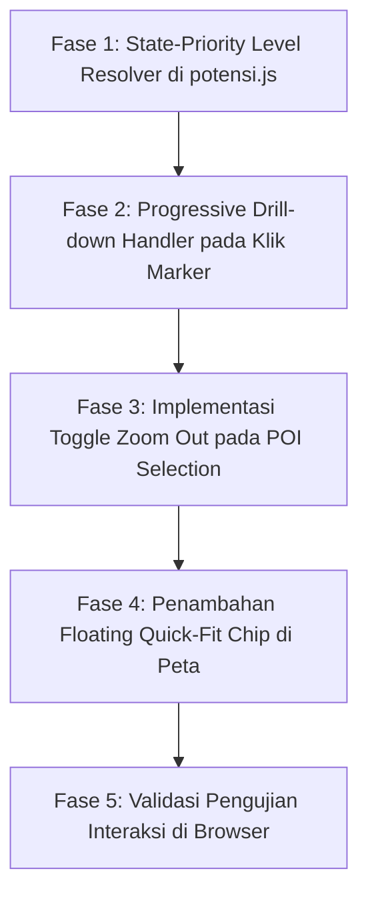

# Dokumen Perencanaan Teknis: Perbaikan Drill-Down Pin Cluster & Navigasi Zoom POI (Peta Potensi PAD360)

| **Atribut** | **Detail** |
|---|---|
| **Tanggal Pembuatan** | 14 Oktober 2026 |
| **Status** | 📋 Menunggu Persetujuan Pengguna (Planning Phase - Jangan Eksekusi Dulu) |
| **Target Berkas** | `potensi.js`, `styles.css` |
| **Dokumen Acuan** | `docs/PLANNING_OPTIMASI_PERFORMA_DAN_VISUAL_POI_PETA.md`, `docs/PLANNING_FIX_MODE_SWITCH_DAN_DYNAMIC_SEMANTIC_ZOOM.md` |
| **Keluhan Pengguna** | Saat pin (cluster/POI) diklik pertama kali peta melakukan zoom, namun saat diklik lagi peta tidak menyesuaikan tempatnya, titik tidak berubah, dan peta tidak melakukan zoom lanjutan (*stuck* di lokasi yang sama). |
| **Bukti Kasus** | Tangkapan layar Provinsi Kalimantan Barat (Dropdown: Kalbar, Kab/Kota: Semua (14), namun di peta masih muncul Pin Provinsi Kalbar `63 POI` bersama provinsi tetangga, dan saat diklik tidak pecah ke kabupaten/kota). |

---

## 1. Analisis Kritis & Akar Masalah Teknis ([High confidence])

Berdasarkan investigasi mendalam terhadap alur kode di [`potensi.js`](file:///c:/laragon/www/PKL/mockup/potensi.js) dan bukti visual yang dilampirkan pengguna:

### 1.1 Akar Masalah Utama: Ketergantungan Kaku pada Angka Zoom Leaflet vs Skala Geografis Nyata
Pada implementasi saat ini di [`potensi.js:L963-1100`](file:///c:/laragon/www/PKL/mockup/potensi.js#L963-L1100), sistem menentukan lapisan apa yang harus di-render **hanya** berdasarkan ambang batas angka zoom Leaflet yang kaku:
* **Zoom $\le 5.5$**: Level 1 (Nasional / 7 Wilayah Pulau)
* **Zoom $5.6 - 8.5$**: Level 2 (Provinsi)
* **Zoom $8.6 - 11.0$**: Level 3 (Kabupaten / Kota Overview)
* **Zoom $> 11.0$**: Level 4 (Detail Lapangan: POI & Koridor)

**Kelemahan Fatal**:
Wilayah geografis provinsi di Indonesia sangat beragam:
* Provinsi kecil seperti DKI Jakarta atau Bali memiliki luas ringkas, sehingga saat di-zoom pas berada pada angka $> 8.5$.
* Sebaliknya, provinsi berukuran raksasa seperti **Kalimantan Barat, Kalimantan Tengah, Papua, dan Sumatera Selatan** membentang ratusan kilometer.
* Ketika pengguna memilih **Kalimantan Barat**, Leaflet menghitung batas wilayah (*bounding box*) 14 kabupaten/kota dan menetapkan zoom otomatis pada **Zoom 7.0 – 7.3**.
* Karena angka zoom 7.2 berada di bawah batas ambang 8.5, sistem secara kaku mengeksekusi percabangan **Level 2 (Provinsi)**!
* **Akibatnya**:
  1. Meskipun pengguna sudah berada di dalam scope Kalimantan Barat (dropdown provinsi aktif, sidebar menampilkan 14 Kabupaten/Kota), peta di layar **tetap menampilkan Pin Provinsi Kalbar (63 POI)** bersama provinsi-provinsi tetangga (Kalteng, Kalsel, Kaltim, Kep. Riau, Babel).
  2. Pin 14 Kabupaten/Kota milik Kalbar (Melawi, Pontianak, Ketapang, Sambas, dll.) **sama sekali tidak di-render di peta**.
  3. Ketika pengguna mengklik pin `Kalbar (63 POI)` di peta, event handler memanggil `selectProvince('kalimantan-barat')`. Fungsi tersebut melakukan `flyToBounds()` ke batas Kalbar yang sama persis (Zoom 7.2).
  4. Peta tidak bergerak, tidak men-zoom lebih dekat, dan pin tidak berubah sama sekali (*stuck*). Pengguna merasa pin "tidak menyesuaikan tempatnya dan tidak ngezoom lagi".

---

### 1.2 Akar Masalah Kedua: Ketiadaan *Hierarchical Drill-Down Trigger* pada Event Klik
* Saat ini, event klik pada pin hanya memanggil fungsi pemilihan level yang sama:
  - Klik pin pulau $\rightarrow$ panggil `selectIsland()`.
  - Klik pin provinsi $\rightarrow$ panggil `selectProvince()`.
* **Kelemahan**: Jika pengguna mengklik pin provinsi yang **sedang aktif**, fungsi seharusnya tidak sekadar mengulang pemanggilan provinsi, melainkan **melakukan *drill-down* ke level berikutnya (Level 3: Kabupaten/Kota)** dengan menaikkan tingkat zoom atau mengubah mode render secara eksplisit.

---

### 1.3 Akar Masalah Ketiga: Perilaku Klik POI Tanpa Fitur Toggle / Reset Fokus
* Di Level 4 (Objek POI), ketika pengguna mengklik salah satu titik POI:
  ```javascript
  selectObject(objId) {
      ...
      this.map.flyTo([obj.lat, obj.lng], 16, { duration: 0.8 });
      ...
  }
  ```
  - Peta melakukan zoom sangat dekat (Zoom 16) ke satu titik objek tersebut.
  - Namun, ketika pengguna mengklik titik POI itu kembali:
    1. Peta tidak melakukan apa-apa karena koordinat dan zoom sudah berada di 16.
    2. Titik-titik POI lain di kota tersebut berada jauh di luar layar (*off-screen*), dan tidak ada mekanisme otomatis untuk kembali melihat seluruh sebaran titik POI kota tersebut (*auto-fit bounds*).

---

## 2. Arsitektur Solusi Teknis: Hybrid Semantic & State-Aware Navigation

Untuk menyelesaikan masalah ini secara tuntas tanpa merusak zoom manual pengguna, sistem menerapkan arsitektur **Hybrid Navigation (State Priority + Dynamic Zoom)**:

```
┌────────────────────────────────────────────────────────────────────────────────────────┐
│                      HYBRID RESOLVER: STATE PRIORITY ENGINE                            │
├────────────────────────────────────────────────────────────────────────────────────────┤
│                                                                                        │
│  1. Apakah pengguna sedang memilih KOTA tertentu? (selectedCity ≠ null)                │
│     └─► YA: WAJIB Render Level 4 (Titik POI & Koridor Jalan Kota Tersebut)             │
│                                                                                        │
│  2. Apakah pengguna sedang memilih PROVINSI tertentu? (selectedProv ≠ null)            │
│     └─► YA: WAJIB Render Level 3 (Gugusan 14 Pin Kab/Kota milik Provinsi Tersebut),    │
│             Abaikan batas zoom 8.5! Kalbar langsung menampilkan pin Melawi, Sambas, dll│
│                                                                                        │
│  3. Apakah pengguna sedang memilih PULAU tertentu? (selectedIsland ≠ null)             │
│     └─► YA: WAJIB Render Level 2 (Pin Provinsi di Pulau Tersebut)                      │
│                                                                                        │
│  4. Jika tidak ada scope wilayah terkunci (Nasional):                                  │
│     └─► Gunakan ambang batas zoom bebas (LoD Semantic Zoom murni)                      │
│                                                                                        │
└────────────────────────────────────────────────────────────────────────────────────────┘
```

---

### 2.1 Perilaku Klik Pin Bertingkat (*Progressive Drill-Down Flow*)

1. **Klik pada Pin Nasional / Pulau (Level 1)**:
   * Mengarahkan pandangan ke pulau tersebut dan langsung memecah pin ke **Pin Provinsi** di pulau tersebut.

2. **Klik pada Pin Provinsi (Level 2 — misal: Klik Pin `Kalbar 63 POI`)**:
   * Sistem mendeteksi bahwa provinsi Kalbar diklik:
     - Set `this.state.selectedProv = prov`.
     - Hitung batas koordinat seluruh kabupaten/kota di provinsi tersebut.
     - **Secara eksplisit pemicu Level 3**: Langsung tampilkan pin seluruh kabupaten/kota milik provinsi tersebut (Melawi, Ketapang, Sambas, Pontianak, dll.).
     - Jika zoom saat ini masih $< 8.0$, peta di-zoom sedikit lebih dekat (*flyToBounds* dengan padding dinamis) sehingga pengguna merasakan efek masuk (*dive-in*).

3. **Klik pada Pin Kabupaten/Kota (Level 3 — misal: Klik Pin `Melawi 4 POI`)**:
   * Sistem mendeteksi kota diklik:
     - Set `this.state.selectedCity = city`.
     - Peta melakukan `flyTo` ke pusat kota (zoom 13.0).
     - **Secara eksplisit pemicu Level 4**: Langsung tampilkan 4 titik POI individual Melawi + koridor jalan.

4. **Klik pada Titik POI Individual (Level 4 — misal: `OBJ-REK-MELAWI-001`)**:
   * **Klik Pertama**:
     - Fokus ke titik objek (Zoom 16, center objek).
     - Buka drawer detail di kanan.
     - Tandai status objek sebagai aktif (`this.state.selectedObject = obj`).
   * **Klik Kedua (pada objek yang sama / toggle)**:
     - Kembalikan kamera peta (*zoom out*) agar mencakup **seluruh titik POI di kota tersebut** (`map.fitBounds(allCityPoiBounds)` atau zoom 13).
     - Ini memberi keleluasaan bagi pengguna untuk berpindah melihat titik POI tetangga tanpa harus memutar roda mouse manual.

---

### 2.2 Integrasi Tombol Floating Cepat ("Lihat Semua POI Kota Ini")
* Saat pengguna sedang berada di zoom mikro (Zoom $\ge 15$ pada objek tunggal):
  Tampilkan chip melayang kecil di sisi atas peta:
  `[ 🔍 Lihat Semua POI di Melawi (4 Titik) ]`
* Mengklik tombol ini langsung mengembalikan tampilan peta ke cakupan seluruh kota secara halus (*smooth zoom-out*).

---

## 3. Matriks Perbandingan Skenario Kalimantan Barat

| Aksi Pengguna | Kondisi Saat Ini (Bermasalah) | Solusi yang Direncanakan (Setelah Diperbaiki) |
|---|---|---|
| **1. Pilih Kalbar di Dropdown** | Peta zoom ke Kalbar (zoom ~7.2). Di layar muncul pin besar `Kalbar 63 POI` bersama Kalteng, Kalsel, Kaltim. | Peta mengarah ke Kalbar. Di layar **langsung muncul 14 pin Kabupaten/Kota Kalbar** (Pontianak, Melawi, Sambas, dll.). Pin provinsi Kalbar hilang digantikan kota-kotanya. |
| **2. Klik Pin Kalbar di Peta** | Peta tidak bergerak sama sekali (*stuck* di zoom 7.2) dan pin tetap `Kalbar 63 POI`. | Pin Kalbar langsung pecah menjadi **14 titik kabupaten/kota**, peta terbang masuk mendekati sebaran kota di Kalbar. |
| **3. Klik Melawi (di peta/sidebar)** | Peta terbang ke Melawi (zoom 13). | Peta terbang ke Melawi (zoom 13) dan menampilkan **4 titik POI individual Melawi**. |
| **4. Klik Objek Reklame Melawi** | Peta zoom ke 16 fokus pada reklame. | Peta zoom ke 16 fokus pada reklame, drawer kanan terbuka. |
| **5. Klik Objek Reklame Lagi** | Peta tidak merespons, tetap di zoom 16. | Peta secara cerdas **zoom out kembali ke zoom 13 (menampilkan seluruh 4 POI Melawi)** sehingga pengguna mudah memilih objek lain. |

---

## 4. Rencana Kerja Implementasi (Phase Breakdown)



### Rincian Modifikasi Berkas:

1. **[`potensi.js`](file:///c:/laragon/www/PKL/mockup/potensi.js)**:
   * Refaktor fungsi `renderMapLayers()` agar mengutamakan `this.state.selectedCity` dan `this.state.selectedProv` di atas ambang batas angka zoom Leaflet murni.
   * Modifikasi handler klik marker provinsi: jika provinsi yang diklik adalah provinsi yang sama atau berada dalam scope, paksa drill-down ke level kota.
   * Modifikasi fungsi `selectObject()`: menambahkan logika *toggle* (jika ID yang diklik sama dengan `this.state.selectedObject?.id`, lakukan *zoom out* kembali ke batas kota).
   * Tambahkan helper `fitCurrentCityBounds()` untuk memudahkan navigasi zoom kembali ke overview kota.

2. **[`styles.css`](file:///c:/laragon/www/PKL/mockup/styles.css)**:
   * Styling tombol/chip floating `potensi-fit-city-chip` (latar putih blur, bayangan lembut, ikon zoom-fit).

---

## 5. Kriteria Keberhasilan (Definition of Done)

* [ ] Memilih Provinsi Kalimantan Barat di dropdown atau mengklik pin Kalbar di peta **langsung memunculkan pin kabupaten/kota di Kalbar**, bukan pin provinsi Kalbar itu sendiri.
* [ ] Mengklik pin provinsi Kalbar tidak lagi macet (*no stuck loop*), melainkan melakukan zoom in progresif dan memecah cluster ke kota-kota Kalbar.
* [ ] Mengklik kabupaten/kota (misal Melawi) langsung mengarahkan kamera dan menampilkan seluruh titik POI milik kota tersebut.
* [ ] Mengklik titik POI yang sedang aktif untuk kedua kalinya mengembalikan zoom kamera agar seluruh titik POI kota tersebut terlihat kembali secara utuh.
* [ ] Tidak ada konflik antara navigasi klik otomatis dan navigasi zoom manual (roda mouse).
