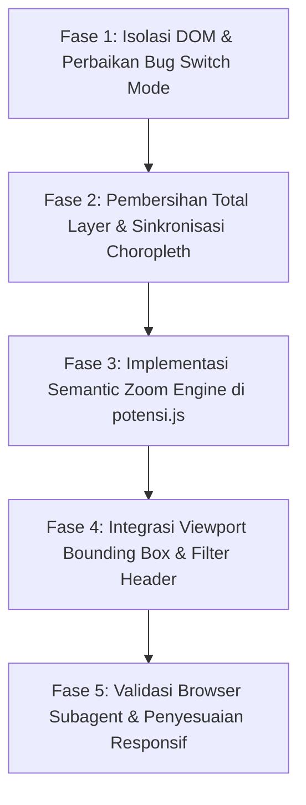

# Dokumen Perencanaan Teknis: Perbaikan Perpindahan Mode & Dynamic Semantic Zoom (Peta Potensi PAD360)

| **Atribut** | **Detail** |
|---|---|
| **Tanggal Pembuatan** | 13 Oktober 2026 |
| **Status** | 📋 Menunggu Persetujuan (Planning Phase) |
| **Target Modul** | Dashboard Utama Portal Data Indonesia (`index.html`, `potensi.js`, `Map.js`, `styles.css`) |
| **Dokumen Terkait** | `docs/PLANNING_FITUR_TABEL_PETA_POTENSI_DAN_KONTRAK_POI.md`, `docs/PLANNING_TAB_PETA_POTENSI.md` |
| **Lampiran Bukti** | Tangkapan Layar Isu Mode Switch (Gambar 1) & Skenario Zoom-out Kota Bandung (Gambar 2) |

---

## 1. Latar Belakang & Identifikasi Masalah

Berdasarkan evaluasi terhadap implementasi operasional sistem, ditemukan 2 isu arsitektural penting yang perlu ditangani:

### 1.1 Isu 1: Desinkronisasi & Kebocoran State pada Perpindahan Mode (Gambar 1)
* **Kondisi Teramati:**
  Pengguna beralih dari **Mode Peta Potensi** kembali ke **Mode Profil Daerah**. Tombol header switcher dan sidebar kiri berhasil kembali ke *Profil Daerah*, namun tampilan peta mengalami desinkronisasi:
  1. Status bar di kiri bawah peta tetap bertuliskan `Mode Potensi: BANTUL · Seluruh Indonesia • 514 Wilayah` dengan indikator dot berwarna hijau toska.
  2. Legenda di pojok kiri bawah tetap menampilkan kotak kategori PAD360 (`Kategori Objek Potensi Pajak (PAD360)`) dan legenda gradien choropleth BPS tidak muncul.
  3. Lapisan poligon wilayah (*choropleth*) BPS hilang atau tidak ter-render dengan benar, serta titik marker potensi masih dapat tertinggal di peta.
* **Akar Masalah Teknis ([High confidence]):**
  1. **Destruksi Struktur DOM Asli oleh `innerHTML`:** Di [`potensi.js`](file:///c:/laragon/www/PKL/mockup/potensi.js), fungsi `updateContextStrip()` dan `updateLegend()` menimpa isi elemen `#mapLegend` dan `#mapContextStrip`. Hal ini menghapus permanen tag elemen bawaan Profil Daerah seperti `<b id="stripMetricLabel">`, `<div id="legendMetricTitle">`, `<span id="scaleMin">`, `<span id="scaleMax">`, dan `.scale-bar`. Akibatnya, saat `Map.js` memanggil fungsi `updateNationalSummary()`, selektor mengembalikan `null` dan legenda/status bar profil gagal dipulihkan.
  2. **Bypass Pembersihan Layer pada Alur Tampilan Tabel:** Pada [`potensi.js`](file:///c:/laragon/www/PKL/mockup/potensi.js), pemanggilan `clearLayersFromMap()` diletakkan di dalam blok `else` dari pengecekan `if (isTableView)`. Jika pengguna beralih mode saat berada di tampilan Tabel, layer marker potensi tidak dibersihkan dari Leaflet map.
  3. **Viewport Ketinggalan:** Viewport peta tidak di-reset ke cakupan nasional saat kembali ke Profil Daerah, melainkan tetap terkunci pada zoom level mikro kota potensi terakhir.

---

### 1.2 Isu 2: Keterbatasan Navigasi Wilayah Peta Potensi saat Zoom Out (Gambar 2)
* **Kondisi Teramati:**
  Saat pengguna sedang memilih kota tertentu (misalnya **Kota Bandung**), sistem mengunci scope pada kota tersebut. Ketika pengguna melakukan *zoom out* untuk melihat pulau Jawa atau daerah lain, peta hanya menampilkan Kota Bandung dan kota-kota tetangganya di Jawa Barat saja. Wilayah di luar Jawa Barat (seperti Jawa Tengah, Banten, Sumatera) tidak menampilkan titik potensi apapun. Pengguna dipaksa mengklik breadcrumbs *"Jawa Barat"* atau *"Nasional"* secara kaku untuk membuka wilayah lain.
* **Kebutuhan Solusi (Dynamic Semantic Zoom):**
  Peta potensi harus fleksibel dan adaptif (*fluid*): tingkat agregasi data (*Level of Detail / LoD*) harus menyesuaikan nilai perbesaran (*zoom level*) peta secara dinamis tanpa mengharuskan pengguna bolak-balik mengklik tombol breadcrumbs/dropdown.

---

## 2. Arsitektur Solusi Teknis

### 2.1 Solusi Masalah 1: Dekoupling DOM & Pembersihan State Total

Untuk menjamin agar kedua mode tidak saling merusak elemen DOM satu sama lain:

1. **Pemisahan Kontainer DOM Permanen (Independent Containers):**
   * Di dalam `index.html`, elemen `#mapLegend` dan `#mapContextStrip` dipisah menjadi 2 kontainer independen yang dikontrol via display/toggling class:
     ```html
     <!-- Status Context Strip -->
     <div class="map-context-strip" id="profileContextStrip">...</div>
     <div class="map-context-strip potensi-variant" id="potensiContextStrip" style="display: none;">...</div>

     <!-- Map Legend -->
     <div class="map-legend" id="profileMapLegend">...</div>
     <div class="map-legend potensi-variant" id="potensiMapLegend" style="display: none;">...</div>
     ```
   * Dengan pendekatan ini, manipulasi DOM di mode Potensi tidak akan pernah menghapus struktur elemen metrik profil BPS.
2. **Pembersihan Layer Tanpa Syarat (Unconditional Layer Cleanup):**
   * `clearLayersFromMap()` wajib dipanggil **sebelum** percabangan tampilan (`isTableView`), memastikan seluruh layer group marker potensi (`clusters`, `poiMarkers`, `corridors`, `checkpoints`) di-detach dari Leaflet map saat keluar dari mode Potensi.
3. **Restorasi Choropleth & Viewport Sinkron:**
   * Saat kembali ke Profil Daerah:
     ```javascript
     if (window.profileGeojsonLayer && this.map && !this.map.hasLayer(window.profileGeojsonLayer)) {
         this.map.addLayer(window.profileGeojsonLayer);
     }
     if (typeof window.applyProfileFilters === 'function') {
         window.applyProfileFilters();
     }
     ```

---

### 2.2 Solusi Masalah 2: Dynamic Semantic Zoom Engine (LoD Hierarkis)

Sistem menerapkan arsitektur *Multi-scale Level of Detail (LoD)* berbasis ambang batas zoom (*zoom thresholds*) pada event `map.on('zoomend')`.

```
Rentang Zoom Leaflet:
 0 ──────── 5.5 ───────────── 8.5 ────────────── 11.0 ────────────── 18
 │  NASIONAL   │    PROVINSI     │   KAB / KOTA     │    DETAIL POI    │
 │ (7 Wilayah) │  (38 Provinsi)  │  (514 Daerah)    │   & KORIDOR JALAN│
 └─────────────┴─────────────────┴──────────────────┴──────────────────┘
```

#### Matriks Ambang Batas & Perilaku Tampilan:

| Ambang Batas Zoom | Tingkat LoD | Entitas Visual yang Ditampilkan | Perilaku Breadcrumbs & Dropdown |
|---|---|---|---|
| **Zoom $\le 5.5$** | **Level 1: Nasional** | 7 Pin Agregat Wilayah Pulau Utama (Sumatera, Jawa, Kalimantan, Sulawesi, Bali-Nusa, Maluku, Papua). | Breadcrumb: `Nasional`<br>Dropdown: *Semua Provinsi* & *Semua Kota*. |
| **Zoom $5.6 - 8.5$** | **Level 2: Provinsi** | Pin Agregat Provinsi untuk **seluruh provinsi yang berada di dalam viewport layar saat ini** (`map.getBounds()`). Pengguna melihat Jabar, Jateng, Jatim secara simultan. | Breadcrumb: `Nasional › [Nama Pulau Terfokus]`<br>Dropdown Provinsi sinkron sesuai wilayah dominan di layar. |
| **Zoom $8.6 - 11.0$** | **Level 3: Kabupaten/Kota** | Pin Agregat Kabupaten/Kota untuk seluruh daerah yang tampak di layar (misal: Bandung, Cimahi, Sumedang, Garut). | Breadcrumb: `Nasional › Jabar › [Daftar Daerah]`<br>Dropdown Kab/Kota terbuka. |
| **Zoom $> 11.0$** | **Level 4: Detail Lapangan** | Titik Marker POI Individual (Billboard Reklame, Parkir, Mall) + Garis Koridor Routing Jalan (OSRM). | Breadcrumb: `Nasional › Jabar › Bandung › [Nama Koridor / POI]`. |

---

### 2.3 Mitigasi Efek Samping & Edge Cases

1. **Pencegahan Stutter / Performance Lag (Debouncing):**
   * Perhitungan render ulang diikat pada event `zoomend` (bukan `zoom` real-time) dengan *debounce* $150\text{ ms}$ agar animasi zoom Leaflet tetap berjalan dengan framerate stabil (60 FPS).
2. **Histeresis (Toleransi Ambang Batas):**
   * Diberikan jeda delta $\pm 0.3$ level zoom untuk mencegah kondisi *flickering* marker bolak-balik saat pengguna melakukan zoom perlahan di sekitar batas ambang.
3. **Dukungan Interaksi Manual vs Otomatis:**
   * Jika pengguna secara eksplisit memilih Kota Bandung melalui dropdown header atau kotak pencarian, sistem melakukan `map.flyTo` ke level 12 (Detail POI).
   * Namun begitu pengguna melakukan zoom out manual melewati batas $< 11.0$, sistem secara otomatis menaikkan level agregasi ke Kabupaten/Kota, dan bila melewati $< 8.5$, otomatis melepas isolasi Jawa Barat sehingga provinsi sekitar (Banten, Jateng) langsung terlihat.

---

## 3. Rencana Kerja Implementasi (Phase Breakdown)



### Rincian Modifikasi Berkas:

1. **`index.html`:**
   * Memisahkan kontainer `#mapContextStrip` menjadi `#profileContextStrip` dan `#potensiContextStrip`.
   * Memisahkan kontainer `#mapLegend` menjadi `#profileMapLegend` dan `#potensiMapLegend`.
2. **`potensi.js`:**
   * Refaktor `updateContextStrip()` dan `updateLegend()` agar hanya memanipulasi kontainer khusus potensi tanpa menyentuh elemen profil daerah.
   * Perbaikan fungsi `setMode('profil')` agar selalu membersihkan layer marker potensi di semua kondisi dan memicu render ulang choropleth BPS.
   * Penambahan *Semantic Zoom Controller* via listener `map.on('zoomend')` dengan ambang batas (5.5, 8.5, 11.0).
   * Implementasi fungsi filter spasial berbasis `map.getBounds()` untuk menampilkan marker provinsi/kota yang masuk dalam jendela pandang.
3. **`Map.js`:**
   * Penambahan fungsi ekspos global `window.restoreProfileView()` untuk memastikan sinkronisasi metrik dan legenda profil saat kembali dari mode potensi.
4. **`styles.css`:**
   * Penyesuaian styling kontainer legenda dan status strip varian potensi agar transisi visibilitas berjalan mulus (*smooth fade*).

---

## 4. Kriteria Keberhasilan (Definition of Done)

* [ ] Pengguna dapat berpindah dari *Profil Daerah* ke *Peta Potensi* dan sebaliknya secara berulang-ulang tanpa ada status strip, legenda, atau marker yang tertinggal/rusak.
* [ ] Legenda gradien BPS dan poligon choropleth kembali muncul secara instan saat beralih ke *Profil Daerah*.
* [ ] Di *Peta Potensi*, saat berada di Kota Bandung lalu melakukan zoom-out:
  * Pada zoom level sedang, seluruh kabupaten/kota di sekitarnya muncul.
  * Pada zoom level regional, provinsi Jawa Barat dan provinsi tetangga (Jateng, Banten, DKI) muncul bersamaan.
  * Pada zoom level nasional, 7 cluster pulau besar muncul rapi.
* [ ] Pemilihan via dropdown atau search tetap berfungsi presisi dan mengarahkan zoom ke level yang sesuai secara instan.
* [ ] Tidak terdapat error pada console browser saat transisi mode dan operasi zoom.

---
*Dokumen ini siap dieksekusi ke tahap pengkodean setelah mendapatkan persetujuan pengguna.*
