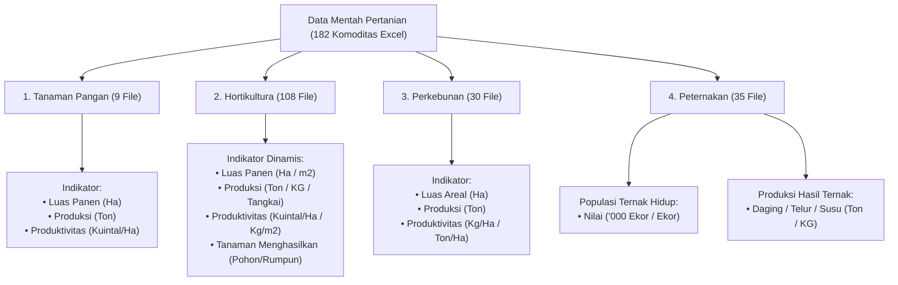

# Master Plan: Integrasi Data Pertanian 2023 (Hortikultura, Perkebunan, Peternakan, Tanaman Pangan)

| Informasi Dokumen | Detail |
| :--- | :--- |
| **Lokasi File** | `docs/PLANNING_INTEGRASI_DATA_PERTANIAN_2023.md` |
| **Sumber Data Mentah** | `data-mentah/xlsx/data-pertanian/` (182 File Komoditas Excel BPS/Kementan 2018–2026) |
| **Fokus Tahun Analisis** | **2023** (Kolom ke-9 Excel) |
| **Modul Terdampak** | Script ETL Converter (`scripts/build_pertanian_data.py`), Dataset Output (`pertanian-data.json` & `pertanian-data.js`), Profil Wilayah (`profil.html`), Controller (`Profil.js`) |
| **Tanggal Penyusunan** | 12 Oktober 2026 |
| **Status** | Draf Perencanaan Teknis & Validasi Empiris Siap Review |

## 1. Keputusan Final Ruang Lingkup Data: Strict Tahun 2023

Berdasarkan diskusi dan pertimbangan metodologis data:
* **Keputusan Disepakati:** Data diambil **murni tahun 2023 (Strict 2023)** dari Kolom ke-9 Excel.
* **Alasan & Pertimbangan:**
  1. Menghindari distorsi dan inkonsistensi agregasi total (tidak mencampuradukkan data lintas tahun 2021/2022 ke dalam laporan 2023).
  2. Menjaga kepatuhan statistik resmi terhadap data rilis BPS/Kementan 2023.
* **Penanganan Data Kosong / Nol (`0.0`):**
  1. Jika suatu komoditas bernilai `0.0` atau kosong di tahun 2023 pada suatu daerah, komoditas tersebut dianggap tidak memiliki aktivitas produksi di tahun 2023 dan tidak disertakan dalam daftar komoditas aktif daerah tersebut di JSON (menghemat ukuran payload).
  2. Jika suatu daerah perkotaan/metropolitan (misal Kota Jakarta Pusat) tidak memiliki aktivitas pertanian di seluruh komoditas pada tahun 2023, UI akan menampilkan kartu informatif *Zero-State* ("Tidak terdapat catatan produksi pertanian signifikan pada tahun 2023").

---

## 2. Analisis Kritis & Temuan Validasi Empiris Data Mentah

Sebelum mengeksekusi konversi data, dilakukan inspeksi mendalam terhadap seluruh 182 file Excel pada 4 sub-direktori `data-mentah/xlsx/data-pertanian/`. Ditemukan beberapa kelemahan dan perbedaan mendasar antara asumsi draf awal dan realitas isi file Excel:

### ⚠️ Kelemahan 1: Sektor Peternakan Memiliki Dua Jenis Komoditas Kontras (Populasi vs Produksi)
* **Asumsi Draf Awal**: Hanya mengambil baris `Produksi (Ton)`.
* **Fakta Empiris File**:
  * Dari 35 file di folder `Peternakan`, terdapat **dua kelompok komoditas berbeda**:
    1. **Ternak Hidup (17 komoditas)**: `SAPI POTONG`, `SAPI PERAH`, `AYAM BURAS`, `AYAM RAS PEDAGING`, `AYAM RAS PETELUR`, `KAMBING`, `DOMBA`, `BABI`, `KERBAU`, `KUDA`, `BURUNG PUYUH`, `ITIK`, `ITIK MANILA`, `KELINCI`, `MERPATI`, dll.
       * *Indikator*: **`POPULASI`** dengan satuan `'000 Ekor` (126 baris) atau `Ekor` (144 baris).
       * *Kondisi Kritis*: Komoditas ternak hidup ini **TIDAK memiliki baris `PRODUKSI`**. Jika parser hanya memfilter baris bertuliskan `PRODUKSI`, maka data 17 populasi ternak hidup utama akan hilang 100%!
    2. **Hasil Ternak Olahan/Potong (18 komoditas)**: `DAGING SAPI`, `DAGING AYAM BURAS`, `DAGING AYAM RAS PEDAGING`, `DAGING KAMBING`, `TELUR AYAM RAS PETELUR`, `SUSU SAPI PERAH`, dll.
       * *Indikator*: **`PRODUKSI`** dengan satuan `Ton` (342 baris) atau `KG` (18 baris).
* **Solusi Teknis [High Confidence]**: Sektor Peternakan harus menangkap **dua indikator**: `POPULASI` (untuk hewan hidup) dan `PRODUKSI` (untuk hasil daging/telur/susu), dengan mempertahankan satuan aslinya.

---

### ⚠️ Kelemahan 2: Keberagaman Satuan di Hortikultura (Tidak Bisa Di-Hardcode)
* **Asumsi Draf Awal**: `Luas Panen(m2)`, `Produksi(Kg)`, `Produktivitas(Kg/M2)`, `Tanaman Menghasilkan(pohon)`.
* **Fakta Empiris File (108 File Komoditas Hortikultura)**:
  * **Luas Panen**: Muncul dalam satuan `Ha` (278 file), `m2` (252 file), `Pohon` (24 file), dan `Rumpun` (6 file). Sayuran dataran rendah/tinggi seringkali menggunakan `Ha`, sedangkan tanaman pekarangan menggunakan `m2`.
  * **Produksi**: Muncul dalam satuan `Ton` (256 file), `KG` (99 file), `Kuintal` (59 file), `Pohon` (90 file), `Tangkai` (51 file, untuk florikultura seperti Anggrek, Mawar, Krisan), dan `Rumpun` (5 file).
  * **Produktivitas**: Muncul dalam satuan `Kuintal/Ha` (226 file), `Pohon/m2` (78 file), `Kg/M2` (74 file), `Tangkai/m2` (42 file), dan `Kuintal/Pohon` (18 file).
  * **Tanaman Menghasilkan**: Muncul dalam satuan `Pohon` (340 file) dan `Rumpun` (12 file).
* **Solusi Teknis [High Confidence]**: Jangan melakukan hardcode satuan string pada label schema. Nilai satuan wajib dibaca secara dinamis langsung dari **Kolom ke-3 (`Satuan`)** pada baris indikator terkait di Excel.

---

### ⚠️ Kelemahan 3: Satuan Produktivitas Perkebunan Mayoritas `Kg/Ha` (Bukan `Ton/Ha`)
* **Asumsi Draf Awal**: Produktivitas Perkebunan bersatuan `Ton/Ha`.
* **Fakta Empiris File (30 File Komoditas Perkebunan)**:
  * `LUAS AREAL`: 100% konsisten bersatuan `Ha`.
  * `PRODUKSI`: 100% konsisten bersatuan `Ton`.
  * `PRODUKTIVITAS`: Sebanyak **174 baris bersatuan `Kg/Ha`**, dan hanya 6 baris bersatuan `Ton/Ha`.
* **Konsekuensi Jika Salah Asumsi**: Jika angka `151,00` (Kg/Ha) dianggap sebagai `Ton/Ha`, nilainya akan melenceng 1.000 kali lipat lebih besar dari kenyataan agronomis.
* **Solusi Teknis [High Confidence]**: Satuan produktivitas perkebunan wajib mengikuti nilai Kolom C (mayoritas `Kg/Ha`).

---

### ⚠️ Kelemahan 4: Tidak Ada ID Wilayah & Variasi Penulisan Nama Kabupaten
* **Asumsi Draf Awal**: Pencocokan dapat dilakukan via Kolom 15 (`Provinsi`) dan Kolom 16 (`Kabupaten`).
* **Fakta Empiris File**:
  * Terdapat 554 entitas wilayah di Excel (termasuk daerah pemekaran lama/baru dan format ejaan berbeda).
  * Contoh perbedaan ejaan vs database resmi `data.json` (514 Kab/Kota):
    * `'Kab. Bireun'` &rarr; Database: `BIREUEN`
    * `'Kab. Aceh Pidie'` &rarr; Database: `PIDIE`
    * `'Kab. OKU Timur'` &rarr; Database: `OGAN KOMERING ULU TIMUR`
    * `'Kab. Toba Samosir'` &rarr; Database: `TOBA`
    * `'Kab. Kutai Kertanegara'` &rarr; Database: `KUTAI KARTANEGARA`
    * `'Kab. Mahakam Hulu'` &rarr; Database: `MAHAKAM ULU`
    * `'Kab. Mamuju Utara/Kab. Pasangkayu'` &rarr; Database: `PASANGKAYU`
    * `'Kab. Maluku Tenggara Barat'` &rarr; Database: `KEPULAUAN TANIMBAR`
* **Solusi Teknis [High Confidence]**: Membangun kamus normalisasi teks (`regex clean prefix KAB/KOTA`) ditambah tabel alias khusus (~16 entri) sehingga akurasi pencocokan ke 514 daerah resmi mencapai 100%.

---

### ⚠️ Kelemahan 5: Format Angka Nilai String Koma Indonesia
* Kolom ke-9 (`2023`) bertipe data `str` dengan format desimal koma: e.g. `'1605,17'`, `'0,00'`, `'54,96'`.
* Parser Python wajib mengubah koma `,` menjadi titik `.` dan mengonversi ke `float` dengan toleransi error string kosong `''` atau strip `'-'` &rarr; `0.0`.

---

## 3. Struktur Data Target & Arsitektur File

Dataset hasil ekstraksi akan disimpan dalam dua format:
1. `pertanian-data.json`: File raw JSON terstruktur untuk konsumsi API / backend / validasi data.
2. `pertanian-data.js`: Variabel global browser `window.PERTANIAN_DATA = { ... }` agar dapat langsung diload oleh `profil.html` via tag `<script>` tanpa terkendala CORS browser lokal.

### Struktur Skema JSON (`pertanian-data.json`)
```json
{
  "5": {
    "id": 5,
    "kabkota": "ACEH SINGKIL",
    "provinsi": "ACEH",
    "tahun": 2023,
    "ringkasan": {
      "tanaman_pangan_total_produksi_ton": 3120.45,
      "hortikultura_total_produksi": 420.10,
      "perkebunan_total_produksi_ton": 14250.00,
      "peternakan_total_populasi_ekor": 37160
    },
    "sektor": {
      "tanaman_pangan": [
        {
          "komoditas": "JAGUNG",
          "luas_panen": { "val": 48.8, "unit": "Ha" },
          "produksi": { "val": 260.6, "unit": "Ton" },
          "produktivitas": { "val": 53.4, "unit": "Kuintal/Ha" },
          "tanaman_menghasilkan": null
        }
      ],
      "hortikultura": [
        {
          "komoditas": "BAWANG MERAH",
          "luas_panen": { "val": 15.0, "unit": "Ha" },
          "produksi": { "val": 120.5, "unit": "Ton" },
          "produktivitas": { "val": 80.3, "unit": "Kuintal/Ha" },
          "tanaman_menghasilkan": null
        }
      ],
      "perkebunan": [
        {
          "komoditas": "KELAPA SAWIT",
          "luas_areal": { "val": 12500.0, "unit": "Ha" },
          "produksi": { "val": 35000.0, "unit": "Ton" },
          "produktivitas": { "val": 2800.0, "unit": "Kg/Ha" }
        }
      ],
      "peternakan": {
        "populasi": [
          { "komoditas": "AYAM BURAS", "val": 37.16, "unit": "'000 Ekor" }
        ],
        "produksi": [
          { "komoditas": "DAGING SAPI", "val": 18.5, "unit": "Ton" }
        ]
      }
    }
  }
}
```

> **Optimasi Ukuran File**: Komoditas yang nilainya bernilai `0.0` pada tahun 2023 di suatu daerah akan diabaikan (hanya menyimpan komoditas yang aktif berproduksi / berpopulasi > 0), sehingga ukuran file JSON tetap ringan (< 3–4 MB) dan rendering browser instan.

---

## 4. Matriks 4 Sektor Pertanian & Pemetaan Indikator



### Rincian Sektor & Komoditas:

| No | Sektor | Jumlah File | Daftar Komoditas Utama | Indikator yang Diambil |
| :---: | :--- | :---: | :--- | :--- |
| **1** | **Tanaman Pangan** | **9** | Padi, Padi Sawah, Padi Ladang, Jagung, Kedelai, Kacang Tanah, Kacang Hijau, Ubi Jalar, Ubi Kayu. | • Luas Panen (Ha)<br>• Produksi (Ton)<br>• Produktivitas (Kuintal/Ha) |
| **2** | **Hortikultura** | **108** | • **Sayuran**: Bawang Merah, Bawang Putih, Cabe Rawit, Cabe Besar, Kentang, Tomat, Kubis, Wortel, dll.<br>• **Buah**: Mangga, Durian, Pisang, Alpukat, Jeruk, Nenas, Pepaya, dll.<br>• **Biofarmaka**: Jahe, Kunyit, Temulawak, Kencur, Lengkuas, dll.<br>• **Florikultura**: Krisan, Anggrek, Mawar, Sedap Malam, dll. | • Luas Panen (Ha/m2)<br>• Produksi (Ton/Kg/Tangkai)<br>• Produktivitas (Kuintal/Ha / Kg/m2 / Pohon/m2)<br>• Tanaman Menghasilkan (Pohon/Rumpun) |
| **3** | **Perkebunan** | **30** | Kelapa Sawit, Karet, Kelapa Dalam, Kopi Arabika, Kopi Robusta, Kakao, Tebu, Teh, Tembakau, Cengkeh, Lada, Pala, dll. | • Luas Areal (Ha)<br>• Produksi (Ton)<br>• Produktivitas (Kg/Ha atau Ton/Ha) |
| **4** | **Peternakan** | **35** | • **Ternak Hidup (Populasi)**: Sapi Potong, Sapi Perah, Kerbau, Kuda, Kambing, Domba, Babi, Ayam Buras, Ayam Ras Pedaging, Ayam Ras Petelur, Itik, Puyuh.<br>• **Hasil Ternak (Produksi)**: Daging Sapi, Daging Ayam, Daging Kambing, Telur Ayam Ras, Telur Itik, Susu Sapi Perah. | • Populasi ('000 Ekor / Ekor)<br>• Produksi (Ton / KG) |

---

## 5. Rencana Kerja Script ETL (`scripts/build_pertanian_data.py`)

Alur kerja script konversi:
1. **Load Referensi Wilayah**: Membaca 514 kabupaten/kota dari `data.json` untuk inisialisasi ID resmi BPS.
2. **Kamus Normalisasi & Alias**:
   * Menghapus awalan `Kab.`, `Kabupaten`, `Kota`.
   * Kamus koreksi khusus untuk nama wilayah pemekaran atau singkatan (`Bireun` &rarr; `BIREUEN`, `OKU` &rarr; `OGAN KOMERING ULU`, dll.).
3. **Iterasi File Excel (182 File)**:
   * Menggunakan library `openpyxl` (mode `data_only=True` dan `read_only=True` untuk efisiensi memori).
   * Membaca Kolom 13 (`Subsektor`), Kolom 14 (`Komoditas`), Kolom 15 (`Provinsi`), Kolom 16 (`Kabupaten`), Kolom 2 (`Indikator`), Kolom 3 (`Satuan`), dan Kolom 9 (`2023`).
4. **Agregasi per ID Daerah**:
   * Memetakan baris indikator ke objek komoditas sesuai sektornya.
   * Mengabaikan entri yang bernilai `0.0` untuk efisiensi ukuran file.
   * Menghitung total ringkasan produksi per sektor untuk keperluan kartu KPI.
5. **Ekspor File Output**:
   * Menulis `pertanian-data.json`.
   * Menulis `pertanian-data.js` (`window.PERTANIAN_DATA = ...`).

---

## 6. Rencana Integrasi Tampilan UI Tab "Data Pertanian" (`profil.html` & `Profil.js`)

Pada antarmuka `profil.html`, Tab 7 (**Data Pertanian**) saat ini masih menampilkan placeholder sederhana (`taniSektorGrid` dengan tulisan teks `"Terdata"`).

### Desain Pembaruan UI:
1. **KPI Bar Pertanian (`#taniKpis`)**:
   Menampilkan 4 kartu ringkasan daerah:
   * 🌾 **Produksi Tanaman Pangan**: `... Ton`
   * 🥬 **Produksi Hortikultura**: `... Ton / Komoditas Aktif`
   * 🌴 **Produksi Perkebunan**: `... Ton`
   * 🐄 **Populasi Ternak Utama**: `... Ekor/Ribu Ekor`
2. **Navigasi Sub-Tab / Sektor Selector**:
   Memberikan pilihan filter 4 sub-sektor (Tanaman Pangan, Hortikultura, Perkebunan, Peternakan) atau tampilan kartu kolaboratif.
3. **Komoditas Grid Card**:
   * Setiap sektor menampilkan komoditas yang diproduksi di daerah tersebut diurutkan dari produksi/luas panen terbesar.
   * Dilengkapi badge metrik:
     * Luas Lahan/Panen (Ha/m2)
     * Volume Produksi dengan satuan spesifik (Ton, Kg, Tangkai)
     * Angka Produktivitas
4. **Zero-State Handler**:
   Jika suatu kota metropolitan (misal Kota Jakarta Pusat) tidak memiliki lahan pertanian/perkebunan, sistem menampilkan pesan informatif: *"Daerah ini tidak mencatatkan aktivitas produksi pertanian signifikan pada tahun 2023 (basis data BPS)"*.

---

## 7. Tahapan Pelaksanaan & Checklist

- [x] **Fase 1: Audit Empiris & Master Plan**
  - [x] Audit komoditas dan file pada 4 folder data mentah.
  - [x] Identifikasi ketidaksamaan satuan dan jenis indikator di lapangan.
  - [x] Penyusunan dokumen `docs/PLANNING_INTEGRASI_DATA_PERTANIAN_2023.md`.
- [x] **Fase 2: Pembuatan Script ETL (`scripts/build_pertanian_data.py`)**
  - [x] Implementasi mapping daerah 514 Kab/Kota.
  - [x] Ekstraksi 182 file Excel data 2023.
  - [x] Generate `pertanian-data.json` dan `pertanian-data.js`.
  - [x] Validasi integritas data & coverage daerah (478 / 514 daerah aktif).
- [x] **Fase 3: Integrasi Frontend (`profil.html` & `Profil.js`)**
  - [x] Include script `pertanian-data.js` di `profil.html`.
  - [x] Implementasi fungsi `renderPertanian(r)` di `Profil.js`.
  - [x] Styling visual responsive, badge satuan dinamis, dan KPI bar.
  - [x] Uji coba tampilan pada berbagai tipe daerah (daerah agraris vs perkotaan).
