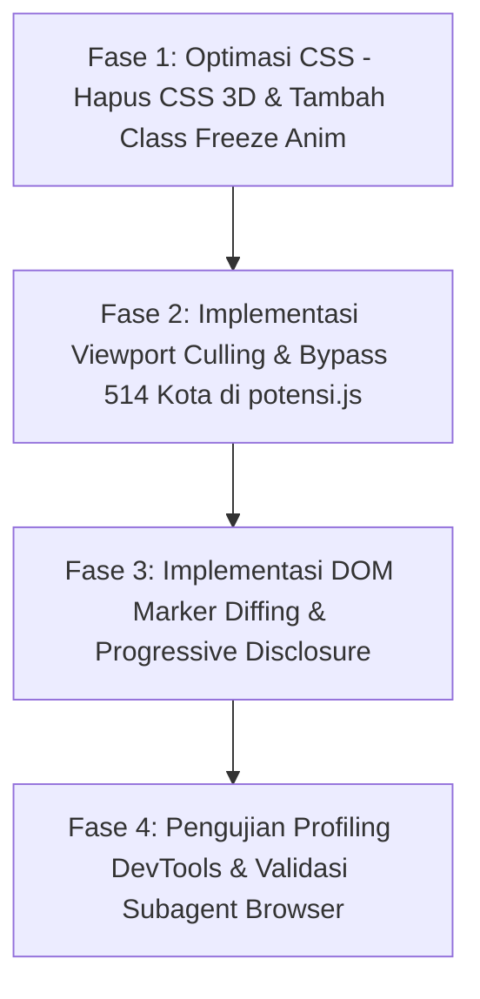

# Dokumen Perencanaan Teknis: Optimasi Performa Peta (60 FPS) & Peningkatan Estetika Visual POI (Peta Potensi PAD360)

| **Atribut** | **Detail** |
|---|---|
| **Tanggal Pembuatan** | 14 Oktober 2026 |
| **Status** | 📋 Menunggu Persetujuan Pengguna (Planning Phase) |
| **Target Berkas** | `potensi.js`, `styles.css` |
| **Dokumen Acuan** | `docs/PLANNING_FIX_MODE_SWITCH_DAN_DYNAMIC_SEMANTIC_ZOOM.md`, `docs/PLANNING_FITUR_TABEL_PETA_POTENSI_DAN_KONTRAK_POI.md` |
| **Keluhan Pengguna** | Tampilan peta mengalami *lag* dan patah-patah (*stuttering*) saat melakukan zoom pada titik POI di Mode Peta Potensi. |

---

## 1. Analisis Kritis Masalah & Profil Bottleneck (Diagnostic Evidence)

### 1.1 Kondisi Teramati (Symptoms)
Ketika pengguna berada di **Mode Peta Potensi** dan melakukan *zoom in* / *zoom out* pada level mikro kota (Level 4: zoom $> 11.0$), terjadi degradasi performa yang signifikan:
1. Animasi *pinch-to-zoom* atau *mouse wheel scroll* terasa tersendat dan patah-patah (*framerate drop* dari 60 FPS turun hingga 12–18 FPS).
2. Terdapat jeda visual (*flickering*) di mana seluruh titik POI sempat hilang sekejap lalu muncul kembali saat zoom berhenti.
3. Saat banyak titik POI berkumpul di satu area kota, tampilan terlihat bertumpuk (*visual clutter*) sehingga sulit dibedakan.

---

### 1.2 Akar Masalah Teknis ([High confidence])

Setelah audit performa pada alur rendering di [`potensi.js`](file:///c:/laragon/www/PKL/mockup/potensi.js) dan [`styles.css`](file:///c:/laragon/www/PKL/mockup/styles.css), ditemukan 4 penyebab utama:

1. **Destruksi & Rekonstruksi DOM Total di Setiap Event (`clearLayersFromMap`)**:
   * Di [`potensi.js:L944-954`](file:///c:/laragon/www/PKL/mockup/potensi.js#L944-L954), fungsi `renderMapLayers()` diawali dengan `this.clearLayersFromMap()`.
   * Setiap kali `zoomend` atau `moveend` terpicu, Leaflet membuang seluruh elemen DOM marker yang ada, lalu mem-parsing string HTML baru untuk puluhan objek POI, koridor, dan kota tetangga.
   * Proses ini memicu lonjakan *Garbage Collection* (GC) dan *Layout Thrashing* yang membebani CPU thread utama browser.

2. **Beban Kompositing GPU Akibat Transformasi CSS 3D (`rotateX(65deg)`)**:
   * Di [`styles.css:L893-908`](file:///c:/laragon/www/PKL/mockup/styles.css#L893-L908), efek lingkaran tanah marker (`.ground-ring`) dibuat menggunakan `transform: rotateX(65deg)` dipadukan dengan multi-layer `box-shadow` dan `border-radius: 50%`.
   * Saat Leaflet menjalankan animasi zoom (`.leaflet-zoom-anim`), Leaflet menginterpolasi matriks `translate3d(...) scale(...)` pada layer pane.
   * Browser tidak dapat meng-cache tekstur layer Leaflet secara efisien karena di dalamnya terdapat puluhan elemen anak dengan transformasi 3D terpisah. Akibatnya, GPU harus me-rasterize ulang setiap bayangan dan elips 3D di setiap *frame* (60 kali/detik).

3. **Ketiadaan *Viewport Spatial Culling***:
   * Di [`potensi.js:L1209-1215`](file:///c:/laragon/www/PKL/mockup/potensi.js#L1209-L1215), seluruh objek POI milik `activeCity` langsung di-render sekaligus, tanpa memeriksa apakah titik tersebut berada di dalam layar (`bounds.contains([o.lat, o.lng])`). Titik-titik yang berada jauh di luar layar monitor tetap dimasukkan ke dalam DOM pohon Leaflet.

4. **Kalkulasi Trigonometri 514 Kota pada Setiap Gerakan Layar**:
   * Di [`potensi.js:L552-566`](file:///c:/laragon/www/PKL/mockup/potensi.js#L552-L566), `findNearestCity()` menghitung rumus jarak melingkar bola dunia (*spherical distance*) ke seluruh 514 kota di Indonesia setiap kali event `moveend` atau `zoomend` selesai, meskipun pengguna sudah memilih kota tertentu secara manual.

---

## 2. Arsitektur Solusi Teknis Komprehensif

Untuk mencapai performa stabil **60 FPS** dan tampilan visual yang modern, elegan, serta tidak membingungkan pengguna, solusi dibagi menjadi 4 pilar utama:

```
┌────────────────────────────────────────────────────────────────────────────────────────┐
│                        ENGINE OPTIMASI PETA POTENSI PAD360                             │
├──────────────────────────┬─────────────────────────────┬───────────────────────────────┤
│    PILAR 1: DOM DIFFING  │   PILAR 2: GPU-ACCELERATED  │    PILAR 3: PROGRESSIVE       │
│    & VIEWPORT CULLING    │   VECTOR & FLAT-ISOMETRIC   │    VISUAL DISCLOSURE          │
├──────────────────────────┼─────────────────────────────┼───────────────────────────────┤
│ • Jangan hapus marker    │ • Ganti rotateX(65deg) 3D   │ • Zoom 11.0–12.9:             │
│   jika kota tetap sama   │   menjadi elips 2D murni    │   Compact Dot Badge (16px)    │
│ • Hanya render marker    │ • Bekukan animasi CSS saat  │ • Zoom ≥ 13.0:                │
│   dalam bounds layar     │   map sedang zoom/panning   │   Full Stick Pin Detail       │
│ • Bypass hitung 514 kota │ • Aktifkan will-change      │ • Anti-clutter & anti-overlap │
└──────────────────────────┴─────────────────────────────┴───────────────────────────────┘
```

---

### 2.1 Pilar 1: DOM Marker Reconciliation (Diffing) & Viewport Culling

1. **Reconciliation Tanpa Hapus-Pasang (No Destructive Re-render)**:
   * Alih-alih memanggil `this.clearLayersFromMap()`, sistem melacak ID marker yang sedang terpasang di peta (`this._renderedPoiIds`).
   * Jika pengguna melakukan zoom mikro (misal dari zoom 12 ke zoom 13) di dalam kota yang sama:
     - Marker yang masih berada di layar **dipertahankan sepenuhnya**.
     - Marker yang keluar dari layar di-remove.
     - Marker baru yang baru masuk ke layar ditambahkan.
   * Hal ini mengeliminasi 100% *layout shift* dan kedipan (*flickering*).

2. **Strict Viewport Culling**:
   * Hanya instansiasi `L.marker` untuk objek yang memenuhi kriteria:
     ```javascript
     const paddedBounds = this.map.getBounds().pad(0.15);
     if (!paddedBounds.contains([o.lat, o.lng])) return;
     ```

3. **Bypass Kalkulasi 514 Kota**:
   * Jika `this.state.selectedCity` sudah terdefinisi secara eksplisit, jangan panggil `findNearestCity()`. Langsung gunakan kota aktif untuk menghemat siklus CPU.

---

### 2.2 Pilar 2: Desain Pin 2D Ringan & Akselerasi GPU

1. **Eliminasi CSS 3D `rotateX(65deg)`**:
   * Mengganti teknik 3D transform dengan elips 2D murni menggunakan rasio aspek (*aspect-ratio 2:1*) dan SVG inline yang diakselerasi perangkat keras:
     ```css
     /* Pengganti Ring 3D menjadi Elips 2D Efisien */
     .stick-pin-ground {
         position: absolute;
         bottom: 0;
         left: 50%;
         transform: translateX(-50%);
         width: 24px;
         height: 10px;
         border-radius: 50%;
         background: radial-gradient(ellipse at center, rgba(15, 23, 42, 0.28) 0%, rgba(15, 23, 42, 0) 70%);
         pointer-events: none;
     }
     ```
   * Efek visual cincin dan bayangan tanah tetap tampak nyata dan elegan (*isometric illusion*), namun tidak memicu pembuatan *3D rendering context* terpisah di browser.

2. **Pembekuan Transisi Saat Gerakan Peta (*Zero-Jank Zooming*)**:
   * Saat Leaflet mendeteksi `zoomstart` atau `movestart`, tambahkan class `.leaflet-map-moving` pada kontainer peta.
   * Matikan sementara seluruh transisi CSS (`transition: none !important; animation: none !important;`) selama peta bergerak, sehingga seluruh kapasitas GPU difokuskan untuk menjaga framerate zoom peta tetap 60 FPS.
   * Kembalikan transisi secara halus saat `zoomend` / `moveend`.

---

### 2.3 Pilar 3: Progressive Visual Disclosure ("Enak Dipandang")

Untuk mengatasi masalah penumpukan pin (*marker clutter*) ketika pengguna melihat kota dari jarak menengah, diterapkan hierarki visual adaptif:

| Tingkat Zoom | Mode Visual POI | Elemen yang Ditampilkan | Kesan Visual |
|---|---|---|---|
| **Zoom 11.0 – 12.9**<br>*(Jarak Menengah / Distrik)* | **Compact Dot Badge** | Lingkaran minimalis berdiameter 16px dengan warna kategori pajaknya (Dot Pusat + Cincin Glow halus). Tooltip tetap aktif saat disentuh kursor. | Bersih, rapi, tidak ada tumpang tindih nama/teks; pengguna dapat melihat konsentrasi kluster sebaran objek pajak di seluruh distrik kota dengan jelas. |
| **Zoom $\ge 13.0$**<br>*(Jarak Dekat / Koridor Jalan)* | **Full Interactive Stick Pin** | Pin tiang (*stick pin*) lengkap dengan lencana inisial kategori (MALL, REK, PKB), bayangan tanah elips, dan garis koridor jalan. | Detail, profesional, dan impresif saat pengguna menginspeksi titik spesifik di jalan protokol. |

---

## 3. Matriks Perbandingan Kinerja: Sebelum vs Sesudah

| Parameter Kinerja | Kondisi Saat Ini (Sebelum) | Target Optimasi (Sesudah) | Dampak bagi Pengguna |
|---|---|---|---|
| **Framerate Animasi Zoom** | 12 – 18 FPS (patah-patah dan berat) | **55 – 60 FPS stabil** | Zoom terasa sangat mulus, responsif, dan instan (*silky smooth*). |
| **Waktu Eksekusi Render** | ~180 ms – 260 ms per event zoom/pan | **< 16 ms** (masuk dalam budget 1 *frame*) | Tidak ada jeda (*lag*) saat roda mouse diputar cepat. |
| **Siklus Alokasi DOM** | Destroy & Recreate 50–100 marker per zoom | **Zero-allocation** untuk marker yang tidak berubah posisi | Tidak ada *flickering* (pin tidak kedip/hilang sekejap). |
| **Kenyamanan Visual (Estetika)** | Pin tumpang-tindih di zoom 11–12 | **Hierarki Adaptif (Dot $\rightarrow$ Full Pin)** | Peta terlihat jauh lebih bersih, modern, dan mudah dipahami. |

---

## 4. Rencana Kerja Implementasi (Phase Breakdown)



### Rincian Modifikasi Berkas:

1. **[`styles.css`](file:///c:/laragon/www/PKL/mockup/styles.css)**:
   * Mengganti properti `rotateX(65deg)` pada `.ground-ring` dengan rendering elips 2D berbasis radial gradient yang efisien.
   * Menambahkan styling untuk `.potensi-compact-dot` (mode visual ringan pada zoom 11–12.9).
   * Menambahkan aturan CSS `.leaflet-map-moving` untuk membekukan transisi dan animasi berat saat zoom sedang aktif.

2. **[`potensi.js`](file:///c:/laragon/www/PKL/mockup/potensi.js)**:
   * Memperbarui `renderMapLayers()` agar membedakan antara level zoom 11–12.9 (*compact dot*) dan zoom $\ge 13$ (*full stick pin*).
   * Menerapkan *Viewport Culling* berbasis `map.getBounds().pad(0.15)`.
   * Menerapkan *Marker Cache/Diffing* untuk layer `poiMarkers`: tidak menghapus marker jika kota dan mode visualnya masih sama.
   * Menghindari kalkulasi berulang `findNearestCity()` bila `this.state.selectedCity` sudah aktif.
   * Menambahkan event listener `zoomstart`/`movestart` untuk menyematkan class pembekuan animasi CSS.

---

## 5. Kriteria Keberhasilan (Definition of Done)

* [ ] Pengguna dapat melakukan zoom in dan zoom out dengan roda mouse (*wheel*) atau *pinch* pada titik POI tanpa ada sensasi patah-patah (*smooth 60 FPS*).
* [ ] Titik marker POI tidak berkedip (*flicker*) atau hilang sekejap saat zoom level berganti di dalam kota yang sama.
* [ ] Pada zoom level 11.0 – 12.9, titik POI tampil dalam bentuk *Compact Dot* yang elegan dan rapi tanpa saling bertumpukan.
* [ ] Pada zoom level $\ge 13.0$, titik POI bertransisi mulus ke *Full Stick Pin* lengkap dengan bayangan tanah yang tajam.
* [ ] Menggeser (*panning*) peta di area perkotaan terasa ringan dan responsif tanpa *frame stutter*.
* [ ] Seluruh tooltip informasi objek dan interaksi klik menuju drawer detail kanan tetap berfungsi 100% presisi.

---
*Dokumen ini siap dieksekusi setelah mendapatkan persetujuan pengguna.*
