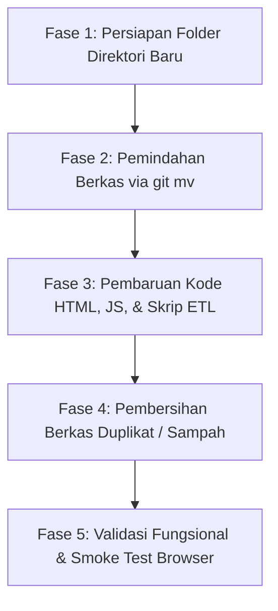

# Master Plan: Reorganisasi Struktur Folder, Pembersihan File Sampah, & Pemetaan Path Modul

| Informasi Dokumen | Detail |
| :--- | :--- |
| **Kode Dokumen** | `PLAN-REFACTOR-001` |
| **Lokasi File** | [`docs/PLANNING_REORGANISASI_STRUKTUR_FILE_DAN_MODULARISASI.md`](file:///c:/laragon/www/PKL/mockup/docs/PLANNING_REORGANISASI_STRUKTUR_FILE_DAN_MODULARISASI.md) |
| **Tanggal Pembuatan**| 21 Oktober 2026 |
| **Kategori** | Refactoring Arsitektur, Housekeeping, & Optimasi Lingkungan Pengembangan |
| **Target Proyek** | Mockup Profil Indonesia & Peta Potensi Pajak (PAD360) |
| **Status Perencanaan**| 🟢 Selesai & Terverifikasi |

---

## 1. Latar Belakang & Masalah Kondisi Saat Ini (As-Is)

Saat ini direktori root proyek [`mockup/`](file:///c:/laragon/www/PKL/mockup) berada dalam kondisi menampung lebih dari 27 berkas bercampur aduk tanpa pemisahan peran (*separation of concerns*). Kondisi ini menimbulkan sejumlah masalah:

1. **Pencemaran Root Direktori (*Root Pollution*)**:
   - File dataset JSON murni (seperti `data.json`, `pertanian-data.json`, `potensi-data.json`, `konsumsi-data.json`, `sosial-data.json`) dan GeoJSON raksasa (`indonesia-kab.json`, `region-boundaries.json`) berserakan berdampingan dengan berkas tampilan (`index.html`, `profil.html`, `styles.css`).
   - File data format ganda (`.js` pembawa window global dan `.json` raw) berada di level yang sama tanpa kategorisasi.
2. **File Sampah & Duplikat Tak Terpakai (*Orphaned Duplicates*)**:
   - Terdapat berkas cadangan manual seperti `Data copy.js` (1.26 MB) dan `data copy.json` (1.26 MB) yang tidak lagi digunakan dan hanya membebani ruang disk serta memicu kebingungan referensi.
3. **Penyebaran Skrip Builder Tidak Konsisten**:
   - Mayoritas generator data berada di [`scripts/`](file:///c:/laragon/www/PKL/mockup/scripts), namun skrip [`build-boundaries.js`](file:///c:/laragon/www/PKL/mockup/build-boundaries.js) tertinggal sendirian di root.
   - File data mentah `Data Kabupaten _ Kota Dalam Angka 2026 - DATA.csv` (330 KB) tertinggal di root, padahal sudah tersedia subdirektori [`data-mentah/csv/`](file:///c:/laragon/www/PKL/mockup/data-mentah/csv).
4. **Resiko Pemindahan Tanpa Perencanaan**:
   - Pemindahan file tanpa pemetaan kode akan langsung melumpuhkan aplikasi karena pemanggilan `<script src="...">`, `<link rel="stylesheet">`, panggilan `fetch()`, serta relative path pada pipeline generator data di Python dan Node.js akan putus (*broken 404*).

---

## 2. Arsitektur Struktur Direktori Target (To-Be)

Struktur target dirancang dengan standar arsitektur web modern yang memisahkan antara berkas presentasi, aset statis (CSS/JS), basis data runtime, data mentah mentah, dan otomasi pipeline skrip:

```text
mockup/
│
├── index.html                                 # Dashboard Utama & Peta Choropleth / PAD360
├── profil.html                                # Halaman Profil Mendalam 514 Daerah
├── README.md                                  # Dokumentasi Utama Proyek
├── vercel.json                                # Konfigurasi Deployment Serverless
├── .gitignore                                 # Aturan Pengabaian Git
│
├── assets/                                    # Seluruh Aset Statis Frontend
│   ├── css/
│   │   └── styles.css                         # Design System & UI Styling
│   └── js/
│       ├── core/                              # Logika Pemrograman & Controller UI
│       │   ├── Map.js                         # Logika Peta Choropleth & Leaderboard
│       │   ├── Profil.js                      # Logika Halaman Profil & 9 Tab Sektoral
│       │   └── potensi.js                     # Logika Peta Potensi Pajak (PAD360)
│       └── data/                              # Bundle Variabel Window Global (No-CORS)
│           ├── Data.js                        # window.indonesiaData (514 Kab/Kota)
│           ├── indonesia-kab.js               # window.INDONESIA_KAB_GEOJSON
│           ├── region-boundaries.js           # window.REGION_BOUNDARIES
│           ├── konsumsi-data.js               # window.KONSUMSI_DATA
│           ├── pertanian-data.js              # window.PERTANIAN_DATA
│           ├── potensi-data.js                # window.PotensiData
│           └── sosial-data.js                 # window.SOSIAL_DATA
│
├── data/                                      # Basis Data Terstruktur (Runtime API & Fetch)
│   ├── geojson/                               # File Spasial Poligon & Batas Geografis
│   │   ├── indonesia-kab.json                 # GeoJSON Poligon 514 Daerah BPS
│   │   └── region-boundaries.json             # Koordinat Batas 4 Penjuru & Envelope
│   └── json/                                  # Dataset Statistik JSON Murni
│       ├── data.json                          # Dataset Indikator Makro Utama BPS
│       ├── konsumsi-data.json                 # Dataset Komoditas Pangan Susenas 2023
│       ├── pertanian-data.json                # Dataset 4 Subsektor Sensus Pertanian 2023
│       ├── potensi-data.json                  # Dataset POI Objek Pajak PAD360
│       └── sosial-data.json                   # Dataset Pendidikan Kemendikbud & Faskes Kemenkes
│
├── data-mentah/                               # Sumber Data Mentah Awal (Ingestion Sources)
│   ├── csv/
│   │   ├── Data Kabupaten _ Kota Dalam Angka 2026 - DATA.csv   # (Dipindahkan dari root)
│   │   ├── Data_Parkiran_Bali.xlsx - Parkiran Bali.csv
│   │   ├── Data_Reklame_Bali.xlsx - Reklame.csv
│   │   ├── Data_Videotron_bali.xlsx - Worksheet.csv
│   │   └── Hasil_Billboard_bali.xlsx - Worksheet.csv
│   ├── json/                                  # Raw Extract JSON mentah
│   │   └── ...
│   └── xlsx/                                  # Raw Excel BPS / Dinas
│       └── ...
│
├── scripts/                                   # Pipeline ETL, Generator, & Enricher Data
│   ├── build-boundaries.js                    # Generator Batas Wilayah (Dipindahkan dari root)
│   ├── build_even_potensi_data.js             # Generator Distribusi Merata POI PAD360
│   ├── build_konsumsi_data.py                 # ETL Komoditas Konsumsi Excel ke JSON/JS
│   ├── build_pertanian_data.py                # ETL Pertanian Excel ke JSON/JS
│   ├── build_sosial_data.py                   # ETL Fasilitas Pendidikan & Kesehatan ke JSON/JS
│   ├── convert_csv_to_json.js                 # Parser CSV Mentah
│   ├── enrich_gmaps_reviews.py                # Enricher Review & Rating Google Maps
│   └── enrich_potensi_data.py                 # Enricher Metadata Kontrak & WhatsApp
│
├── Referensi/                                 # Berkas Acuan Desain Asli (Tidak Diubah)
│   └── ...
│
└── docs/                                      # Dokumentasi Teknis & Master Planning
    ├── PLANNING_REORGANISASI_STRUKTUR_FILE_DAN_MODULARISASI.md  # (Dokumen Ini)
    └── ... (10 dokumen planning fitur lainnya)
```

---

## 3. Matriks Inventaris & Rencana Tindakan Berkas

Tabel berikut memetakan setiap berkas di root, status pelacakan Git, tindakan yang akan diambil, dan lokasi barunya:

| No | Berkas Asal (Root) | Ukuran | Status Git | Tindakan | Lokasi Target Baru |
| :---: | :--- | :---: | :---: | :---: | :--- |
| **A** | **File Tampilan & Konfigurasi** | | | | |
| 1 | `index.html` | ~71 KB | Tracked | **Tetap** (Update tag `<link>` & `<script>`) | `index.html` |
| 2 | `profil.html` | ~44 KB | Tracked | **Tetap** (Update tag `<script>`) | `profil.html` |
| 3 | `styles.css` | ~38 KB | Tracked | **Pindah (`git mv`)** | `assets/css/styles.css` |
| 4 | `README.md` | ~5 KB | Tracked | **Tetap** (Update diagram struktur) | `README.md` |
| 5 | `vercel.json` | 27 B | Tracked | **Tetap** | `vercel.json` |
| 6 | `.gitignore` | 246 B | Tracked | **Tetap** | `.gitignore` |
| **B** | **Logika Frontend (Core Controllers)** | | | | |
| 7 | `Map.js` | ~68 KB | Tracked | **Pindah (`git mv`)** + Update fetch path | `assets/js/core/Map.js` |
| 8 | `Profil.js` | ~113 KB | Tracked | **Pindah (`git mv`)** | `assets/js/core/Profil.js` |
| 9 | `potensi.js` | ~131 KB | Tracked | **Pindah (`git mv`)** + Update fetch path | `assets/js/core/potensi.js` |
| **C** | **Bundle Data Window Global (`.js`)** | | | | |
| 10 | `Data.js` | 1.26 MB | Tracked | **Pindah (`git mv`)** | `assets/js/data/Data.js` |
| 11 | `indonesia-kab.js` | 691 KB | Tracked | **Pindah (`git mv`)** | `assets/js/data/indonesia-kab.js` |
| 12 | `region-boundaries.js` | 376 KB | Tracked | **Pindah (`git mv`)** | `assets/js/data/region-boundaries.js` |
| 13 | `konsumsi-data.js` | 5.61 MB | Tracked | **Pindah (`git mv`)** | `assets/js/data/konsumsi-data.js` |
| 14 | `pertanian-data.js` | 6.44 MB | Tracked | **Pindah (`git mv`)** | `assets/js/data/pertanian-data.js` |
| 15 | `potensi-data.js` | 6.81 MB | Tracked | **Pindah (`git mv`)** | `assets/js/data/potensi-data.js` |
| 16 | `sosial-data.js` | 1.58 MB | Tracked | **Pindah (`git mv`)** | `assets/js/data/sosial-data.js` |
| **D** | **Dataset Spasial & GeoJSON (`.json`)** | | | | |
| 17 | `indonesia-kab.json` | 691 KB | Tracked | **Pindah (`git mv`)** | `data/geojson/indonesia-kab.json` |
| 18 | `region-boundaries.json` | 376 KB | Tracked | **Pindah (`git mv`)** | `data/geojson/region-boundaries.json` |
| **E** | **Dataset Statistik JSON Murni (`.json`)** | | | | |
| 19 | `data.json` | 1.26 MB | Tracked | **Pindah (`git mv`)** | `data/json/data.json` |
| 20 | `konsumsi-data.json` | 11.16 MB | Tracked | **Pindah (`git mv`)** | `data/json/konsumsi-data.json` |
| 21 | `pertanian-data.json` | 12.54 MB | Tracked | **Pindah (`git mv`)** | `data/json/pertanian-data.json` |
| 22 | `potensi-data.json` | 6.81 MB | Tracked | **Pindah (`git mv`)** | `data/json/potensi-data.json` |
| 23 | `sosial-data.json` | 2.59 MB | Tracked | **Pindah (`git mv`)** | `data/json/sosial-data.json` |
| **F** | **Skrip Pipeline & Data Mentah Tercecer** | | | | |
| 24 | `build-boundaries.js` | ~17 KB | Tracked | **Pindah (`git mv`)** + Update path IO | `scripts/build-boundaries.js` |
| 25 | `Data Kabupaten _ Kota...csv` | 331 KB | Tracked | **Pindah (`git mv`)** | `data-mentah/csv/Data Kabupaten _ Kota Dalam Angka 2026 - DATA.csv` |
| **G** | **File Sampah & Duplikat (Delete)** | | | | |
| 26 | `Data copy.js` | 1.26 MB | Untracked | **Hapus Permanen (`rm`)** | *- Dihapus -* |
| 27 | `data copy.json` | 1.26 MB | Untracked | **Hapus Permanen (`rm`)** | *- Dihapus -* |

---

## 4. Rincian Perubahan Kode Eksplisit (*Code Impact*)

Berikut adalah pemetaan tepat baris kode (*exact line-by-line*) yang wajib diperbarui saat file berpindah tempat:

### 4.1. Pembaruan File Entry Point HTML

#### A. File [`index.html`](file:///c:/laragon/www/PKL/mockup/index.html)

**1. Pembaruan Link Stylesheet (Baris 14):**
```diff
-    <link rel="stylesheet" href="styles.css">
+    <link rel="stylesheet" href="assets/css/styles.css">
```

**2. Pembaruan Script Tags di Bawah Body (Baris 1978–1983):**
```diff
     <script src="https://cdnjs.cloudflare.com/ajax/libs/leaflet/1.9.4/leaflet.min.js"></script>
-    <script src="Data.js"></script>
-    <script src="indonesia-kab.js"></script>
-    <script src="potensi-data.js"></script>
-    <script src="potensi.js"></script>
-    <script src="Map.js"></script>
+    <script src="assets/js/data/Data.js"></script>
+    <script src="assets/js/data/indonesia-kab.js"></script>
+    <script src="assets/js/data/potensi-data.js"></script>
+    <script src="assets/js/core/potensi.js"></script>
+    <script src="assets/js/core/Map.js"></script>
```

---

#### B. File [`profil.html`](file:///c:/laragon/www/PKL/mockup/profil.html)

**Pembaruan Script Tags di Bawah Body (Baris 727–734):**
```diff
 <script src="https://cdnjs.cloudflare.com/ajax/libs/leaflet/1.9.4/leaflet.min.js"></script>
-<script src="indonesia-kab.js"></script>
-<script src="Data.js"></script>
-<script src="region-boundaries.js?v=5.0"></script>
-<script src="konsumsi-data.js"></script>
-<script src="pertanian-data.js"></script>
-<script src="sosial-data.js"></script>
-<script src="Profil.js?v=5.0"></script>
+<script src="assets/js/data/indonesia-kab.js"></script>
+<script src="assets/js/data/Data.js"></script>
+<script src="assets/js/data/region-boundaries.js?v=5.0"></script>
+<script src="assets/js/data/konsumsi-data.js"></script>
+<script src="assets/js/data/pertanian-data.js"></script>
+<script src="assets/js/data/sosial-data.js"></script>
+<script src="assets/js/core/Profil.js?v=5.0"></script>
```

---

### 4.2. Pembaruan Panggilan `fetch()` Asinkron di Runtime

Karena `index.html` dijalankan dari root domain/folder server, pemanggilan relative URL pada browser mengacu pada URL dokumen induk (`index.html`).

#### A. File [`assets/js/core/Map.js`](file:///c:/laragon/www/PKL/mockup/Map.js)
Pada fungsi fallback pemuatan GeoJSON (`loadGeoJSON`):
```diff
     async function loadGeoJSON() {
         if (typeof window !== 'undefined' && window.INDONESIA_KAB_GEOJSON && Array.isArray(window.INDONESIA_KAB_GEOJSON.features)) {
             allGeoJsonFeatures = window.INDONESIA_KAB_GEOJSON.features.filter(f => f.geometry !== null);
             console.log('GeoJSON loaded from script bundle:', allGeoJsonFeatures.length, 'features');
             createOrUpdateMarkers();
             return;
         }
         try {
-            const res = await fetch('indonesia-kab.json');
+            const res = await fetch('data/geojson/indonesia-kab.json');
             if (res.ok) {
                 const data = await res.json();
```

#### B. File [`assets/js/core/potensi.js`](file:///c:/laragon/www/PKL/mockup/potensi.js)
Pada fungsi pemuatan data potensi (`loadData`):
```diff
         async loadData() {
             this.data = typeof window !== 'undefined' && window.PotensiData ? window.PotensiData : null;
             try {
-                const res = await fetch('potensi-data.json');
+                const res = await fetch('data/json/potensi-data.json');
                 if (res.ok) {
                     this.data = await res.json();
```

---

### 4.3. Pembaruan Skrip Pipeline ETL & Generator Data di `scripts/`

Ketika skrip-skrip dijalankan dari dalam folder `scripts/`, jalur relative ke file input/output harus diperbarui agar tidak menulis balik ke root folder.

#### A. File [`scripts/build-boundaries.js`](file:///c:/laragon/www/PKL/mockup/build-boundaries.js) (Setelah dipindah ke `scripts/`)
```diff
 const fs = require('fs');
 const path = require('path');
 
-const dataPath = path.join(__dirname, 'data.json');
-const geoPath = path.join(__dirname, 'indonesia-kab.json');
+const dataPath = path.join(__dirname, '..', 'data', 'json', 'data.json');
+const geoPath = path.join(__dirname, '..', 'data', 'geojson', 'indonesia-kab.json');
```
Dan pada bagian penyimpanan output (Baris ~395 & ~399):
```diff
-fs.writeFileSync(path.join(__dirname, 'region-boundaries.json'), JSON.stringify(RESULT, null, 2), 'utf8');
+fs.writeFileSync(path.join(__dirname, '..', 'data', 'geojson', 'region-boundaries.json'), JSON.stringify(RESULT, null, 2), 'utf8');

-fs.writeFileSync(path.join(__dirname, 'region-boundaries.js'), jsContent, 'utf8');
+fs.writeFileSync(path.join(__dirname, '..', 'assets', 'js', 'data', 'region-boundaries.js'), jsContent, 'utf8');
```

---

#### B. File [`scripts/build_pertanian_data.py`](file:///c:/laragon/www/PKL/mockup/scripts/build_pertanian_data.py)
Baris 11–14:
```diff
 base_dir = os.path.dirname(os.path.abspath(__file__))
 root_dir = os.path.abspath(os.path.join(base_dir, '..'))
 
-data_json_path = os.path.join(root_dir, 'data.json')
+data_json_path = os.path.join(root_dir, 'data', 'json', 'data.json')
 pertanian_dir = os.path.join(root_dir, 'data-mentah', 'xlsx', 'data-pertanian')
-output_json_path = os.path.join(root_dir, 'pertanian-data.json')
-output_js_path = os.path.join(root_dir, 'pertanian-data.js')
+output_json_path = os.path.join(root_dir, 'data', 'json', 'pertanian-data.json')
+output_js_path = os.path.join(root_dir, 'assets', 'js', 'data', 'pertanian-data.js')
```

---

#### C. File [`scripts/build_konsumsi_data.py`](file:///c:/laragon/www/PKL/mockup/scripts/build_konsumsi_data.py)
Baris 6–8:
```diff
 excel_path = os.path.join(os.path.dirname(__file__), '..', 'data-mentah', 'xlsx', 'Merge Konsumsi 2023.xlsx')
-output_json_path = os.path.join(os.path.dirname(__file__), '..', 'konsumsi-data.json')
-output_js_path = os.path.join(os.path.dirname(__file__), '..', 'konsumsi-data.js')
+output_json_path = os.path.join(os.path.dirname(__file__), '..', 'data', 'json', 'konsumsi-data.json')
+output_js_path = os.path.join(os.path.dirname(__file__), '..', 'assets', 'js', 'data', 'konsumsi-data.js')
```

---

#### D. File [`scripts/build_sosial_data.py`](file:///c:/laragon/www/PKL/mockup/scripts/build_sosial_data.py)
Saat ini skrip memanggil `open('data.json')` dan menulis ke `'sosial-data.json'` secara lokal di working directory. Kita standarkan menggunakan `root_dir`:
```diff
+base_dir = os.path.dirname(os.path.abspath(__file__))
+root_dir = os.path.abspath(os.path.join(base_dir, '..'))
+data_json_path = os.path.join(root_dir, 'data', 'json', 'data.json')
+output_json_path = os.path.join(root_dir, 'data', 'json', 'sosial-data.json')
+output_js_path = os.path.join(root_dir, 'assets', 'js', 'data', 'sosial-data.js')

 def load_regions():
-    with open('data.json', 'r', encoding='utf-8') as f:
+    with open(data_json_path, 'r', encoding='utf-8') as f:
         data = json.load(f)
```
Dan pada fungsi `main()` (Baris 415–424):
```diff
-    json_path = 'sosial-data.json'
+    json_path = output_json_path
     print(f"Menyimpan ke {json_path}...")
     with open(json_path, 'w', encoding='utf-8') as f:
         json.dump(reg_by_id, f, ensure_ascii=False, indent=2)
         
-    js_path = 'sosial-data.js'
+    js_path = output_js_path
     print(f"Menyimpan ke {js_path}...")
```

---

#### E. File [`scripts/build_even_potensi_data.js`](file:///c:/laragon/www/PKL/mockup/scripts/build_even_potensi_data.js)
Baris 4 & 263:
```diff
-const srcPath = path.join(__dirname, '..', 'potensi-data.json');
+const srcPath = path.join(__dirname, '..', 'data', 'json', 'potensi-data.json');
...
-const jsPath = path.join(__dirname, '..', 'potensi-data.js');
+const jsPath = path.join(__dirname, '..', 'assets', 'js', 'data', 'potensi-data.js');
```

---

#### F. File [`scripts/enrich_potensi_data.py`](file:///c:/laragon/www/PKL/mockup/scripts/enrich_potensi_data.py) & [`scripts/enrich_gmaps_reviews.py`](file:///c:/laragon/www/PKL/mockup/scripts/enrich_gmaps_reviews.py)
Standarisasi path pembacaan dan penulisan payload:
```python
base_dir = os.path.dirname(os.path.abspath(__file__))
root_dir = os.path.abspath(os.path.join(base_dir, '..'))
fpath_js = os.path.join(root_dir, 'assets', 'js', 'data', 'potensi-data.js')
fpath_json = os.path.join(root_dir, 'data', 'json', 'potensi-data.json')
```

---

### 4.4. Pembaruan File Dokumentasi [`README.md`](file:///c:/laragon/www/PKL/mockup/README.md)

Diagram struktur direktori pada baris 65–75 di [`README.md`](file:///c:/laragon/www/PKL/mockup/README.md#L65-L75) diperbarui sesuai struktur arsitektur modular yang baru.

---

## 5. Rencana Tahapan Eksekusi (Execution Strategy)

Eksekusi akan dilakukan secara bertahap dalam 5 fase aman:



### Fase 1: Persiapan Folder Direktori Baru
Membuat folder penampung jika belum ada:
- `assets/css`
- `assets/js/core`
- `assets/js/data`
- `data/geojson`
- `data/json`

### Fase 2: Pemindahan Berkas Menggunakan `git mv`
Menggunakan perintah `git mv` untuk memastikan riwayat commit dan blame tetap utuh tanpa terputus:
```bash
# 1. Stylesheet
git mv styles.css assets/css/styles.css

# 2. Logika Frontend Core
git mv Map.js assets/js/core/Map.js
git mv Profil.js assets/js/core/Profil.js
git mv potensi.js assets/js/core/potensi.js

# 3. Bundle Data JS (window globals)
git mv Data.js assets/js/data/Data.js
git mv indonesia-kab.js assets/js/data/indonesia-kab.js
git mv region-boundaries.js assets/js/data/region-boundaries.js
git mv konsumsi-data.js assets/js/data/konsumsi-data.js
git mv pertanian-data.js assets/js/data/pertanian-data.js
git mv potensi-data.js assets/js/data/potensi-data.js
git mv sosial-data.js assets/js/data/sosial-data.js

# 4. GeoJSON Data
git mv indonesia-kab.json data/geojson/indonesia-kab.json
git mv region-boundaries.json data/geojson/region-boundaries.json

# 5. Raw JSON Datasets
git mv data.json data/json/data.json
git mv konsumsi-data.json data/json/konsumsi-data.json
git mv pertanian-data.json data/json/pertanian-data.json
git mv potensi-data.json data/json/potensi-data.json
git mv sosial-data.json data/json/sosial-data.json

# 6. Builder & Raw CSV
git mv build-boundaries.js scripts/build-boundaries.js
git mv "Data Kabupaten _ Kota Dalam Angka 2026 - DATA.csv" "data-mentah/csv/Data Kabupaten _ Kota Dalam Angka 2026 - DATA.csv"
```

### Fase 3: Pembaruan Kode Terkoordinasi
Menerapkan seluruh modifikasi baris kode yang dirinci pada **Seksi 4**:
1. Edit [`index.html`](file:///c:/laragon/www/PKL/mockup/index.html) (CSS link & 5 JS script tags).
2. Edit [`profil.html`](file:///c:/laragon/www/PKL/mockup/profil.html) (7 JS script tags).
3. Edit [`assets/js/core/Map.js`](file:///c:/laragon/www/PKL/mockup/Map.js) (`fetch('data/geojson/indonesia-kab.json')`).
4. Edit [`assets/js/core/potensi.js`](file:///c:/laragon/www/PKL/mockup/potensi.js) (`fetch('data/json/potensi-data.json')`).
5. Edit skrip generator di [`scripts/`](file:///c:/laragon/www/PKL/mockup/scripts).
6. Edit [`README.md`](file:///c:/laragon/www/PKL/mockup/README.md).

### Fase 4: Pembersihan Berkas Duplikat
Menghapus file fisik duplikat yang tidak terpakai:
- Hapus `Data copy.js`
- Hapus `data copy.json`

### Fase 5: Validasi Pengujian & Smoke Test
Menjalankan pengujian ketat sebelum commit:
1. **Network & Console Audit**:
   - Buka `index.html` di browser. Buka DevTools Console. Pastikan **0 error 404** untuk resource CSS/JS/JSON dan **0 Uncaught ReferenceError**.
   - Buka `profil.html?id=158` (Kota Denpasar) dan daerah lain. Pastikan seluruh 9 tab sektoral (Geografi, Pemerintahan, Parlemen, Penduduk, Ekonomi, Konsumsi, Pertanian, Pendidikan, Kesehatan) terisi data normal.
2. **Fitur Mode Switch & Drilldown**:
   - Uji perpindahan mode dari Profil Daerah ke Peta Potensi Pajak (PAD360) dan sebaliknya.
   - Uji drilldown pin cluster reklame/parkir/mall.
   - Uji table view di kedua mode.
3. **Pemeriksaan Skrip ETL**:
   - Jalankan dry-run atau periksa sintaks skrip ETL untuk memastikan tidak ada kesalahan relative import/path.

---

## 6. Checklist Verifikasi Hasil Akhir

- [x] Folder root bersih: hanya menyisakan `index.html`, `profil.html`, `README.md`, `vercel.json`, `.gitignore`, `.vercelignore`, dan subdirektori resmi (`assets/`, `data/`, `data-mentah/`, `scripts/`, `Referensi/`, `docs/`).
- [x] Tidak ada file `*copy*` atau file backup yang tertinggal di root.
- [x] Seluruh file CSS dan JS logic berada di dalam `assets/`.
- [x] Seluruh file JSON dan GeoJSON berada rapi di dalam `data/`.
- [x] Seluruh 514 daerah di peta tematik dan peta potensi tetap render sempurna.
- [x] Halaman profil detail 514 daerah dengan 9 tab sektoral berfungsi 100% tanpa error data.
- [x] Riwayat Git tetap terjaga rapi melalui `git mv`.
